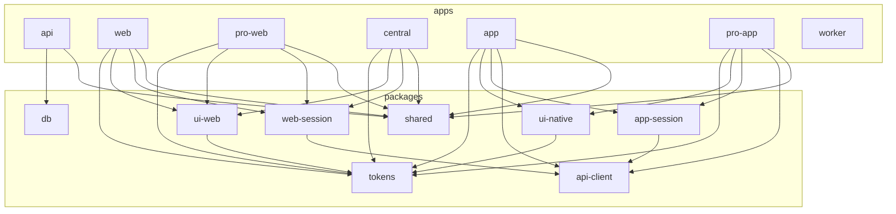

# Documentación técnica

Cómo está construido el proyecto, por subproyecto, sin datos de marca. Para lo que hace cada tipo de usuario, ver [flujos](../flujos/README.md); para decisiones, los ADR de cada fase en `docs/fases/`.

| Documento                          | Cubre                                                                                                                                  |
| ---------------------------------- | -------------------------------------------------------------------------------------------------------------------------------------- |
| [integracion.md](integracion.md)   | Cómo se comunican las piezas: contrato, sesiones, permisos, datos, archivos, procesos en segundo plano y recorridos entre aplicaciones |
| [api.md](api.md)                   | `apps/api`: configuración, ciclo de una petición y cada módulo con sus endpoints y reglas                                              |
| [webs.md](webs.md)                 | `apps/web`, `apps/pro-web` y `apps/central`: cada ruta, qué carga y qué acciones ofrece                                                |
| [apps-moviles.md](apps-moviles.md) | `apps/app`, `apps/pro-app` y `apps/worker`                                                                                             |
| [paquetes.md](paquetes.md)         | Cada paquete de `packages/`, las herramientas del monorepo y las pruebas de punta a punta                                              |

Complementan estos documentos, sin repetirlos:

- [Modelo de datos](../arquitectura/modelo-de-datos.md)
- [Convenciones de la API](../arquitectura/api.md)
- [Seguridad](../arquitectura/seguridad.md)
- [Entornos y puertos](../arquitectura/entornos.md)
- [Decisión de stack](../stack/2026-11-02-salimos.md)

## Mapa del monorepo

Revisado contra el código de la rama principal el 2026-11-07.
