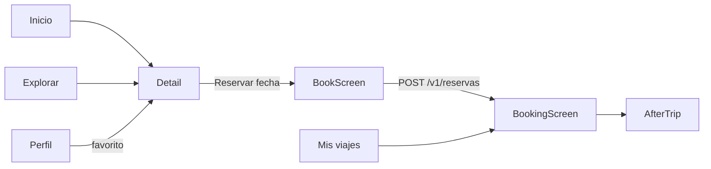
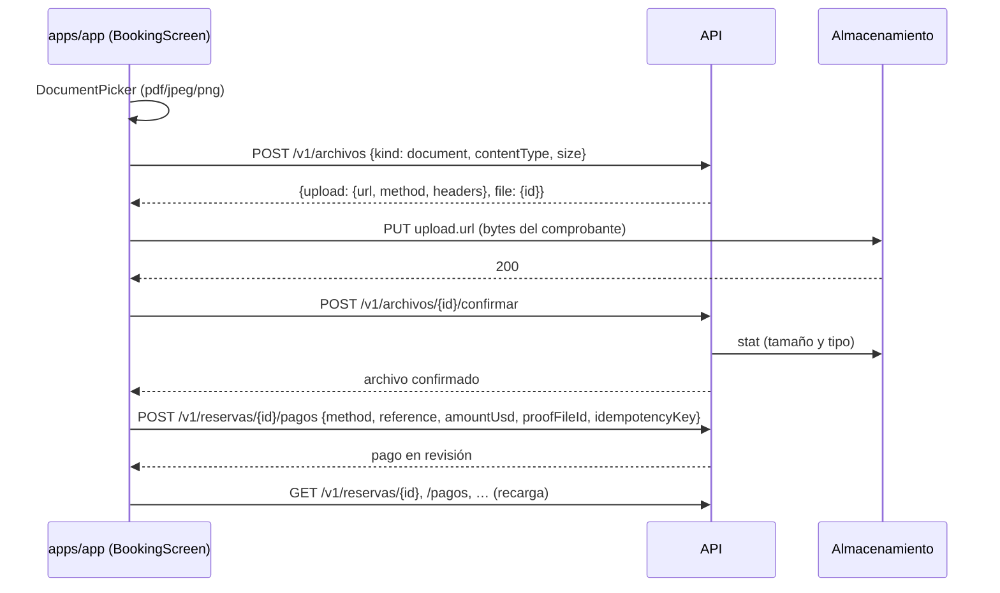

# Apps móviles y worker

Documentación técnica de las dos apps Expo / React Native del monorepo y del proceso `apps/worker`:

| Subproyecto    | Paquete            | Para quién                                        | Pantalla raíz tras iniciar sesión             |
| -------------- | ------------------ | ------------------------------------------------- | --------------------------------------------- |
| `apps/app`     | `@salimos/app`     | Viajero: buscar, reservar, pagar, viajar, reseñar | `Main` en `apps/app/src/explore.tsx`          |
| `apps/pro-app` | `@salimos/pro-app` | Equipo de una agencia: check-in del día           | `Operator` en `apps/pro-app/src/operator.tsx` |
| `apps/worker`  | `@salimos/worker`  | Proceso en segundo plano (hoy vacío)              | `apps/worker/src/main.ts`                     |

Todo lo descrito sale del código actual. Documentos relacionados: [API](api.md), [paquetes compartidos](paquetes.md), [webs](webs.md), [integración entre subproyectos](integracion.md), [arquitectura de la API](../arquitectura/api.md), [entornos](../arquitectura/entornos.md), [seguridad](../arquitectura/seguridad.md), [modelo de datos](../arquitectura/modelo-de-datos.md), y los flujos de producto [app del viajero](../flujos/salimos-app.md) y [Pro app](../flujos/pro-app.md).

## 1. Base común de las dos apps

### 1.1 Configuración Expo

Las dos apps son proyectos Expo SDK 57 (`expo ~57.0.27`, `react-native 0.86.3`, `react 19.2.3`) sin Expo Router: la navegación es estado de React dentro de un único componente.

| Clave de `app.json`                    | `apps/app/app.json` | `apps/pro-app/app.json` |
| -------------------------------------- | ------------------- | ----------------------- |
| `expo.slug`                            | `salimos`           | `salimos-pro`           |
| `expo.version`                         | `1.0.0`             | `1.0.0`                 |
| `orientation`                          | `portrait`          | `portrait`              |
| `userInterfaceStyle`                   | `light`             | `dark`                  |
| `ios.supportsTablet`                   | `true`              | `true`                  |
| `android.predictiveBackGestureEnabled` | `false`             | `false`                 |

No hay `plugins`, `scheme` (deep links), `bundleIdentifier` ni `package` de Android, ni `eas.json`.

**Todavía no:** builds firmadas ni publicación en tiendas. Sin `bundleIdentifier`/`package` ni configuración EAS, las apps solo corren en Expo Go, en simulador/emulador o en la vista previa web.

### 1.2 Arranque

- `index.ts` (igual en ambas) llama a `registerRootComponent(App)`.
- `App.tsx` (`apps/app/App.tsx`, `apps/pro-app/App.tsx`):
  1. Crea **una** sesión a nivel de módulo con `createSession({ baseUrl, store: deviceTokenStore() })`.
  2. Espera a `useBrandFonts()` de `@salimos/ui-native`; mientras no carguen las fuentes, devuelve `null`.
  3. Envuelve todo en `ThemeProvider` con `product="salimos"` o `product="pro"`.
  4. En web, si la URL trae `?muestra`, muestra `Showcase` (catálogo de componentes) en lugar de la app.
  5. Si no, monta `AuthGate`, que entrega `(user, signOut)` a la pantalla raíz (`Main` u `Operator`).

### 1.3 URL de la API

```ts
baseUrl: process.env.EXPO_PUBLIC_API_URL ?? 'http://localhost:4000';
```

- `EXPO_PUBLIC_API_URL` se incrusta en tiempo de compilación del bundle (prefijo `EXPO_PUBLIC_` de Expo). Cambiarla exige reiniciar `expo start` o volver a exportar.
- El valor por defecto apunta a la API local en el puerto 4000.
- En un teléfono físico `localhost` es el propio teléfono: hay que arrancar con `EXPO_PUBLIC_API_URL=http://<IP del computador>:4000` (comentario en `App.tsx`).
- En el emulador de Android `localhost` también es el emulador: o se usa la IP del computador, o se redirige el puerto con `adb reverse tcp:4000 tcp:4000`. Esta instrucción no está en el código ni en otros documentos del repositorio; es la consecuencia directa del valor por defecto.
- Las llamadas desde la vista previa web salen del navegador, por eso `CORS_ORIGINS` de la API incluye `http://localhost:3010` y `http://localhost:3011` (`apps/api/src/config.ts:20`, `.env.example`). Las apps instaladas no necesitan CORS.

### 1.4 Sesión: `@salimos/app-session`

Paquete compartido (`packages/app-session/src/`) en TypeScript plano salvo `auth-gate.tsx` y `store.ts`, para poder probarlo con `node --test` (`session.test.ts`, `checkin.test.ts`).

**`createSession`** (`packages/app-session/src/session.ts`):

| Pieza                 | Comportamiento                                                                                                                                                                                                                                                                                                                                                                                                                                                                        |
| --------------------- | ------------------------------------------------------------------------------------------------------------------------------------------------------------------------------------------------------------------------------------------------------------------------------------------------------------------------------------------------------------------------------------------------------------------------------------------------------------------------------------- |
| Cliente               | `createApiClient(baseUrl)` de `@salimos/api-client` (cliente tipado generado del contrato OpenAPI). Un middleware `onRequest` añade `Authorization: Bearer <accessToken>`.                                                                                                                                                                                                                                                                                                            |
| Tokens                | El access token vive solo en memoria. El refresh token se guarda en el `TokenStore`.                                                                                                                                                                                                                                                                                                                                                                                                  |
| `call(request)`       | Ejecuta la petición; si responde 401, renueva y la repite **una** vez. Todas las pantallas llaman a la API a través de `session.call`.                                                                                                                                                                                                                                                                                                                                                |
| `renew()`             | `POST /v1/auth/renovar` con el refresh token. Renovaciones concurrentes comparten una sola promesa (`renewing ??=`). Solo un **401 de la API** cierra la sesión; sin red, el token guardado se conserva para el siguiente intento.                                                                                                                                                                                                                                                    |
| `restore()`           | Al arrancar: renueva y carga `GET /v1/yo`. Si falla, pasa a `signedOut`.                                                                                                                                                                                                                                                                                                                                                                                                              |
| `signIn(step, typed)` | Pasos `enter`, `create`, `verify`, `recover`, `reset`. Valida en el cliente con `EmailSchema`, `PasswordSchema` (solo `create`/`reset`) y `OtpCodeSchema` (solo `verify`/`reset`) de `@salimos/shared`. Endpoints: `/v1/auth/entrar`, `/v1/auth/registrar`, `/v1/auth/verificar`, `/v1/auth/recuperar`, `/v1/auth/restablecer`. El error `email_not_verified` en `entrar` lleva al paso `verify` (la API ya envió el código). Sin red devuelve `No hay conexión. Inténtalo de nuevo.` |
| `signOut()`           | `POST /v1/auth/salir` sin esperar éxito y borra el token local siempre.                                                                                                                                                                                                                                                                                                                                                                                                               |
| Estado                | `getState()` / `subscribe()`; `status` es `loading`, `signedOut` o `signedIn`.                                                                                                                                                                                                                                                                                                                                                                                                        |

**`AuthGate`** (`packages/app-session/src/auth-gate.tsx`): se suscribe con `useSyncExternalStore`, llama a `restore()` al montar, devuelve `null` mientras carga, muestra `WelcomeScreen` y luego `SignInScreen` (de `@salimos/ui-native`) hasta tener usuario, y entonces renderiza `children(user, signOut)`.

**Almacenamiento** (`packages/app-session/src/store.ts`):

- `deviceTokenStore()`: `expo-secure-store` bajo la clave `salimos.refresh` (Keychain en iOS, Keystore en Android). En web no hay almacenamiento seguro: el token vive en una variable y la sesión dura hasta recargar la página.
- `deviceCache()`: `@react-native-async-storage/async-storage` para datos que deben estar sin señal (vouchers, lista de pasajeros, marcas pendientes). No guarda secretos.

**Todavía no:** inicio de sesión con Google en las apps. La API tiene `apps/api/src/auth/google.ts`, pero ni `session.ts` ni `SignInScreen` lo usan; las apps solo entran con correo y contraseña.

### 1.5 Interfaz compartida: `@salimos/ui-native`

Las pantallas solo componen piezas de `packages/ui-native/src/`: `Text`, `Button`, `Field`, `Select`, `Chip`, `Card`, `Alert`, `EmptyState`, `FulldayCard`, `TabBar`, `QrCode`, `WelcomeScreen`, `SignInScreen`, `Showcase`, `ThemeProvider`/`useTheme` y `useBrandFonts`. Los valores visuales vienen de `@salimos/tokens`. Las reglas de negocio que se repiten en web y API (precios, etiquetas, validación de selección, QR, firma de vouchers) vienen de `@salimos/shared`. Detalle en [paquetes](paquetes.md).

### 1.6 Dependencias

| Dependencia                                           | `app` | `pro-app` | Uso                                                     |
| ----------------------------------------------------- | :---: | :-------: | ------------------------------------------------------- |
| `@salimos/api-client`                                 |   ✓   |     ✓     | Cliente tipado de la API                                |
| `@salimos/app-session`                                |   ✓   |     ✓     | Sesión, caché, check-in                                 |
| `@salimos/shared`                                     |   ✓   |     ✓     | Reglas, etiquetas, `quote`, `qrMatrix`, `verifyVoucher` |
| `@salimos/tokens`, `@salimos/ui-native`               |   ✓   |     ✓     | Componentes y valores visuales                          |
| `expo-secure-store`                                   |   ✓   |     ✓     | Refresh token                                           |
| `@react-native-async-storage/async-storage`           |   ✓   |     ✓     | Caché sin señal                                         |
| `expo-document-picker`                                |   ✓   |     —     | Elegir el comprobante de pago                           |
| `expo-font`, `expo-status-bar`, `@expo/metro-runtime` |   ✓   |     ✓     | Fuentes, barra de estado, runtime web                   |
| `react-dom`, `react-native-web`                       |   ✓   |     ✓     | Vista previa en navegador                               |

### 1.7 Cómo ejecutarlas

| Comando                                      | Qué hace                                                                                                                                       |
| -------------------------------------------- | ---------------------------------------------------------------------------------------------------------------------------------------------- |
| `pnpm dev`                                   | Infraestructura, migraciones, almacenamiento y `turbo run dev` de todo **excepto** las dos apps (raíz `package.json`). Deja la API en `:4000`. |
| `pnpm dev:app` / `pnpm dev:pro-app`          | `expo start` de cada app. Se abre con Expo Go (QR en la terminal), o con `a`/`i` para emulador/simulador.                                      |
| `pnpm --filter @salimos/app android` / `ios` | `expo start --android` / `--ios`.                                                                                                              |
| `pnpm --filter @salimos/app typecheck`       | `tsc --noEmit`.                                                                                                                                |
| `pnpm --filter @salimos/app build`           | `expo export --platform android --platform web` → `apps/app/dist/` (igual para `pro-app`).                                                     |

**Vista previa web.** El `build` exporta también la plataforma web a `dist/`. Las pruebas end-to-end la sirven como estático (`playwright.config.ts`):

```bash
python3 -m http.server 3010 --directory apps/app/dist      # app del viajero
python3 -m http.server 3011 --directory apps/pro-app/dist  # Pro app
```

Pruebas que la usan: `e2e/mobile-preview.spec.ts` (contraste de componentes, crear cuenta/confirmar/salir, buscar un fullday y guardarlo en favoritos) y `e2e/operator.spec.ts` (check-in sin señal y sincronización).

**Todavía no:** pruebas en dispositivo real. Lo verificado es la vista previa web y las pruebas unitarias de `app-session`; la reserva, el pago y los vouchers de `apps/app` no tienen prueba end-to-end propia en la vista previa (sí en la web, ver [webs](webs.md)).

### 1.8 Decisiones de estructura comunes

- Navegación por estado (`useState`), sin librería de navegación ni enlaces profundos. El gesto "atrás" del sistema no navega dentro de la app; hay botones "Volver" (`ponytail:` en `apps/app/src/explore.tsx` y `apps/pro-app/src/operator.tsx`).
- Márgenes superiores fijos (`paddingTop: 64`) en vez de safe-area insets.
- **Todavía no:** notificaciones push. Ninguna app registra un token de notificaciones; los avisos llegan por los canales que entrega la API (ver §4) y, en la app, como lista dentro de la reserva.

## 2. `apps/app`: app del viajero

### 2.1 Mapa de pantallas

`Main` (`apps/app/src/explore.tsx`) decide qué mostrar con tres estados:

| Estado | Tipo                                          | Efecto                                                              |
| ------ | --------------------------------------------- | ------------------------------------------------------------------- |
| `tab`  | `'home' \| 'explore' \| 'trips' \| 'profile'` | Pestaña activa del `TabBar` (Inicio, Explorar, Mis viajes, Perfil). |
| `open` | `string \| null`                              | Id del fullday cuyo detalle está abierto.                           |
| `flow` | `{ departureId } \| { bookingId } \| null`    | Reservando una salida, o viendo una reserva.                        |

Prioridad de render: `flow.departureId` → `BookScreen`; `flow.bookingId` → `BookingScreen`; `open` → `Detail`; si no, la pestaña. Cambiar de pestaña limpia `flow` y `open`.



### 2.2 Catálogo: `explore.tsx`

**`useLoad(load, key)`**: hook local que carga y vuelve a cargar cuando cambia `key`; expone `{ data, failed, loading }` e ignora respuestas de peticiones viejas (`current`).

**`Results`** — lista de salidas.

- Endpoint: `GET /v1/salidas` con la query recibida.
- Muestra `FulldayCard` por `DepartureCard`: foto tamaño `md` (nunca la original), fecha (`es-VE`, UTC), cupos (`Sin cupos`, `Queda 1 puesto`, `Quedan N puestos`), precio `$N` o `Consultar` si `priceUsd` es `null`.
- Errores: `No pudimos cargar las salidas. Revisa tu conexión.`; vacío: `No hay salidas con esos filtros`.

**`Home` (Inicio)**: saludo con `user.name`, chips de `FULLDAY_CATEGORIES` (uno a la vez, se puede deseleccionar) y `Results` con `{ categoria }`.

**`Explore` (Explorar)**:

| Control                                                         | Parámetro de `GET /v1/salidas`                  |
| --------------------------------------------------------------- | ----------------------------------------------- |
| Campo "¿A dónde?" + botón Buscar o tecla buscar                 | `q` (texto recortado; solo se aplica al enviar) |
| Chips de `INCLUDES` `lunch`, `shade`, `access` (multiselección) | `incluye=lunch,shade,…`                         |
| Chip "Solo verificadas"                                         | `verificados=1`                                 |

**`Detail`** — ficha de un fullday.

- Endpoints en paralelo: `GET /v1/fulldays/{id}` y `GET /v1/tasa`.
- Muestra: foto `lg`, título y descripción de `sheet.general`, destino, `DURATION_TYPES`, agencia con `badge` (`verified` → "Agencia verificada", si no "Agencia nueva"), precio "desde" (mínimo `priceUsd` de las salidas) y su equivalente con `bolivares(from, rate)`.
- Inclusiones agrupadas con `inclusions(sheet)`: incluye, opcional con costo, se paga en destino (con `cashAtDestination.usd` aproximado), no incluye.
- Próximas salidas: botón "Reservar <fecha>" solo si `status === 'open'` y `seatsLeft > 0`.
- Error: `No pudimos abrir este fullday.`

**Favoritos** (en `Main`):

- Carga: `GET /v1/yo/favoritos` al montar y tras cada cambio.
- Alternar desde el detalle: `PUT` o `DELETE /v1/yo/favoritos/{fulldayId}`.
- `Profile` (Perfil) los lista con la próxima fecha (`nextDate`) y tiene el botón "Salir" (`signOut`).

### 2.3 Reserva: `BookScreen` (`apps/app/src/booking.tsx`)

1. Carga en paralelo `GET /v1/salidas/{id}` (`DepartureAvailability`: ficha, precio, cupos, existencias por plato en `mealOptions`) y `GET /v1/tasa`. Preselecciona el primer punto de embarque y el primer tipo de habitación.
2. El viajero elige:
   - punto de embarque (`sheet.transfer.boardingPoints`, con hora de salida);
   - cantidad por tipo de pasajero (`Stepper` 0–30). Se ofrece `adult` siempre y los demás tipos solo si la ficha tiene tarifa para ellos;
   - tipo de habitación solo si `sheet.general.nights > 0`;
   - plato por pasajero para cada comida `mode === 'choice'`, con "Escoger después" (`later`, no se envía) y sin los platos agotados (`mealOptions[id] === 0`).
3. Precio: `quote(sheet, selection, { date, adultPriceUsd })` de `@salimos/shared`, la misma función con la que cobra la API. Muestra líneas, total, equivalente en bolívares, abono para confirmar (`depositUsd`) y saldo con fecha límite (`balanceUsd`, `balanceDueDate`).
4. Validación previa al envío (el botón queda deshabilitado mientras haya problemas):
   - `Agrega al menos un pasajero.`
   - los mensajes de `checkSelection(sheet, selection)`;
   - `Solo quedan N puestos.` si los asientos (pasajeros sin contar `infant`) superan `seatsLeft`.
5. "Apartar y pagar": `POST /v1/reservas` con `{ departureId, selection }`. Éxito → `BookingScreen` con el id. Error → primer `issues[].message`, o `message`, o `Algo salió mal. Inténtalo de nuevo.`

El apartado (`held`) tiene vencimiento (`heldUntil`); lo libera la API (ver §4).

### 2.4 Reserva existente: `BookingScreen`

**Carga** (`load`), todo con `session.call`:

| Endpoint                            | Para qué                                                                                     |
| ----------------------------------- | -------------------------------------------------------------------------------------------- |
| `GET /v1/reservas/{id}`             | Estado, código, líneas, total, pagado, saldo, instrucciones de pago de la agencia, reembolso |
| `GET /v1/reservas/{id}/pagos`       | Pagos reportados y su estado                                                                 |
| `GET /v1/ajustes`                   | `paymentMethods` habilitados                                                                 |
| `GET /v1/tasa`                      | Tasa en bolívares                                                                            |
| `GET /v1/reservas/{id}/cancelacion` | Vista previa del reembolso si cancela hoy (`refundUsd`, `rule`)                              |

El monto sugerido es lo que falta del abono (`depositUsd − paidUsd − pendientes`) o, si ya se cubrió, el saldo menos pagos pendientes.

**Estados que muestra**: `held` con hora de vencimiento (`Falta tu pago para confirmar`), `in_review` (`La agencia está revisando tu pago`), vouchers en `deposit_paid` y `paid`. Se considera viva toda reserva que no esté en `expired`, `cancelled`, `completed` ni `no_show`.

**Reportar pago** (si la reserva está viva y debe algo):

- Campos: método (`Select` con los métodos de `/v1/ajustes`), monto USD (acepta coma decimal), referencia y comprobante opcional.
- Comprobante: `DocumentPicker.getDocumentAsync` con tipos `application/pdf`, `image/jpeg`, `image/png` y `copyToCacheDirectory: true`.
- Subida en tres pasos (`uploadProof`), igual que en la web:
  1. `POST /v1/archivos` con `{ kind: 'document', contentType, size }`. La API valida tipo (`application/pdf`, `image/jpeg`, `image/png`) y tamaño (1 B a 10 MB) en `apps/api/src/files/files.controller.ts` y devuelve `upload` (URL prefirmada, método y cabeceras, válida diez minutos) y `file.id`.
  2. `fetch(upload.url, { method, headers, body })` con el blob leído de la URI local: los bytes van directo al almacenamiento S3 compatible, no pasan por la API.
  3. `POST /v1/archivos/{id}/confirmar`: la API comprueba que el objeto existe con el tamaño y tipo declarados; si no, lo borra.
- Luego `POST /v1/reservas/{id}/pagos` con `{ method, reference, amountUsd, proofFileId, idempotencyKey }`. La clave de idempotencia (`app-<timestamp>-<aleatorio>`) es una por intento: reenviar el mismo intento con mala red nunca registra dos pagos; se renueva solo tras un éxito.
- Mensajes: `No se pudo subir el comprobante.` / `… Revisa tu conexión.` (fallo del PUT), errores de validación de la API, y al éxito `Pago reportado. La agencia lo revisará.`



**Pagos reportados**: monto, método (`PAYMENT_METHOD_LABELS`), estado (`PAYMENT_STATUS_LABELS`), referencia, tasa aplicada y `statusReason` si la agencia lo rechazó.

**Vouchers** (`loadVouchers`):

- Primero lee la copia local `salimos.vouchers.<bookingId>` de `deviceCache`; luego pide `GET /v1/reservas/{id}/vouchers` y la sobrescribe. La API solo los emite en `deposit_paid`/`paid` (`apps/api/src/tripday/tripday.controller.ts`, `VouchersController`).
- Cada voucher es un texto firmado con Ed25519 por la API (`signVoucher` en `packages/shared/src/voucher.ts`); la app lo dibuja con `qrMatrix(token)` y `QrCode` (260 px), sin red.
- Si la reserva no carga pero hay vouchers guardados, muestra `Sin señal` y solo los vouchers.

**Avisos de la agencia**: `GET /v1/reservas/{id}/avisos`, uno por `Alert`. Se cargan junto con los vouchers.

**Cancelación**: texto con la vista previa (`Si cancelas hoy se te devuelven $N` o `no hay reembolso`, más la regla) y botón "Cancelar la reserva" → `POST /v1/reservas/{id}/cancelar` y recarga. Si hay reembolso registrado (`booking.refund`), muestra `Reembolso enviado` o `Reembolso pendiente`.

**`TripsScreen` (Mis viajes)**: `GET /v1/reservas`; tarjetas con título, fecha, estado (`BOOKING_STATUS_LABELS`), pagado/total y botón "Ver reserva <código>".

### 2.5 Después del viaje: `aftertrip.tsx`

`AfterTrip` se monta dentro de `BookingScreen`:

| Bloque       | Condición en la app              | Endpoints                                                                                                                                                                                          |
| ------------ | -------------------------------- | -------------------------------------------------------------------------------------------------------------------------------------------------------------------------------------------------- |
| `Review`     | `booking.status === 'completed'` | `POST /v1/reservas/{id}/resena` con `{ rating 1–5, aspects: {}, fulfilled, comment? }`                                                                                                             |
| `ClaimsCard` | `booking.paidUsd > 0`            | `GET /v1/reclamos` (filtrado por `bookingId` en el cliente), `POST /v1/reservas/{id}/reclamos` `{ subject, text }`, `POST /v1/reclamos/{id}/mensajes` `{ text }`, `POST /v1/reclamos/{id}/escalar` |

- Reseña: si `booking.reviewed`, muestra `Ya reseñaste este viaje. ¡Gracias!`. La API exige reserva `completed` (alguien abordó), una sola reseña y un plazo de `REVIEW_WINDOW_DAYS = 30` días (`apps/api/src/posttrip/reviews.controller.ts`, `packages/shared/src/booking.ts:350`). El campo de comentario avisa `No escribas teléfonos ni enlaces.`; el filtrado lo hace la API.
- Reclamos: hilo de mensajes por autor (`Tú`, `La agencia`, `Salimos`), estado (`CLAIM_STATUS_LABELS`), resolución de la central. Se puede responder mientras no esté `resolved` y escalar a la central mientras esté `open`.
- Errores: primer `issues[].message`, `message` o `Algo salió mal. Inténtalo de nuevo.`. Tras una reseña, `onChanged` recarga la reserva.

## 3. `apps/pro-app`: modo operador

### 3.1 Quién ve qué

`Operator` (`apps/pro-app/src/operator.tsx`) toma la **primera** membresía de `user.memberships` cuyo `permissions` incluya `checkin`. Según `packages/shared/src/access.ts`:

| Rol de agencia | Permisos                  | En la Pro app                                                     |
| -------------- | ------------------------- | ----------------------------------------------------------------- |
| `owner`        | todos (incluye `checkin`) | Todas las salidas de hoy y mañana de la agencia                   |
| `guide`        | `checkin`, `notices`      | Solo las salidas donde está en `departure.guideIds`               |
| `operations`   | sin `checkin`             | `Tu rol no hace check-in`                                         |
| `finance`      | sin `checkin`             | `Tu rol no hace check-in`                                         |
| sin membresías | —                         | `Esta app es para agencias y guías` (remite a la app del viajero) |

La API aplica la misma regla: `@Can('checkin')` en cada endpoint y, para `guide`, filtro por `guideIds` en el listado y `403` al abrir una salida ajena (`departureFor` en `apps/api/src/tripday/tripday.controller.ts`).

**Todavía no:** elegir agencia si la persona trabaja en varias; se usa la primera con `checkin`. La gestión del resto de la agencia (fichas, salidas, pagos, equipo) vive en la web Pro, no en esta app (ver [webs](webs.md)).

### 3.2 Salidas de hoy y mañana

- `GET /v1/pro/{providerId}/salidas/hoy`: salidas no canceladas con fecha entre hoy (calendario de Venezuela, `todayInVenezuela()`) y mañana, con `passengers` y `boarded` contados sobre reservas confirmadas (`deposit_paid`, `paid`, `completed`, `no_show`).
- La respuesta se guarda en `salimos.checkin.<providerId>.today`. Sin señal se muestra esa copia con `Sin señal: mostrando lo guardado.`, para poder abrir las listas ya descargadas.
- Se recarga cada vez que se vuelve de una salida (`open` en las dependencias del efecto).

### 3.3 Lista de pasajeros (manifiesto) y caché sin señal

Al abrir una salida, `Boarding` crea un `Checkin` con `createCheckin` (`packages/app-session/src/checkin.ts`):

- `download`: `GET /v1/pro/{providerId}/salidas/{departureId}/pasajeros`. El manifiesto trae `keys` (llaves públicas de vouchers por id), `departure` (`id`, `date`, `title`, `status`) y `passengers` (código de reserva, posición, tipo, nombre, cédula, restricciones, platos en texto, `balanceUsd`, `checkin`, `checkinAt`).
- `open()` lee primero las marcas pendientes del teléfono, intenta descargar y guarda la lista en `salimos.checkin.<departureId>.manifest`. Devuelve `network`, `device` (sin señal, con copia) o `none` (`Sin señal y sin lista guardada. Abre esta salida una vez con conexión.`).
- `passengers()` es la lista del servidor con la última marca pendiente de cada pasajero encima: lo que ve el guía.

La pantalla muestra contadores (`A bordo`, `Por llegar`, `No vinieron`, `Con saldo`), búsqueda por nombre/cédula/código sin distinguir acentos ni mayúsculas, platos, restricciones y la deuda (`Su reserva debe $N`).

### 3.4 Marcas de check-in

- `mark(passengerId, 'boarded' | 'no_show' | null)` añade `{ passengerId, checkin, at }` a la cola `salimos.checkin.<departureId>.pending`, con `at` según el reloj del teléfono. `null` deshace una marca.
- Tras cada marca la pantalla intenta `sync()` en segundo plano. El botón "Sincronizar" aparece mientras haya marcas pendientes; sin señal muestra `Sin señal. Las marcas siguen guardadas en este teléfono.`
- `sync()` envía una copia de la cola a `POST /v1/pro/{providerId}/salidas/{departureId}/checkins` (`events`, de 1 a 500), adopta como lista el manifiesto que responde la API y quita de la cola solo las marcas enviadas (las hechas durante la petición siguen pendientes).

**Regla de conflicto (API, `sync` en `tripday.controller.ts`)**: cada pasajero conserva la marca más reciente **por hora de la marca** (`checkinAt < at`), no por orden de llegada. Dos guías que sincronizan en cualquier orden terminan con la misma lista. Solo se aplican marcas de pasajeros de esa salida con reserva confirmada. La API guarda `checkinById` y deja en auditoría `{ received, applied }`.

**Tolerancia de reloj**: `CLOCK_TOLERANCE_MS = 10 min`. Una marca fechada más de diez minutos por delante del reloj del servidor se descarta, porque ganaría a todas las posteriores.

```mermaid
sequenceDiagram
  participant G as Pro app (Boarding)
  participant C as deviceCache (AsyncStorage)
  participant API as API
  G->>API: GET /v1/pro/{providerId}/salidas/{departureId}/pasajeros
  API-->>G: manifiesto {keys, departure, passengers}
  G->>C: guarda salimos.checkin.<id>.manifest
  Note over G: Sin señal
  G->>G: mark() o scan(voucher) con verifyVoucher local
  G->>C: guarda marca en salimos.checkin.<id>.pending
  G-xAPI: sync() falla → marcas siguen en el teléfono
  Note over G: Vuelve la señal
  G->>API: POST …/checkins {events: [{passengerId, checkin, at}]}
  API->>API: descarta at > ahora + 10 min; aplica si checkinAt < at
  API-->>G: manifiesto actualizado
  G->>C: guarda manifiesto y cola sin las marcas enviadas
```

### 3.5 Validación de vouchers sin red

- El campo acepta el texto del voucher; si coincide con `/^[\w-]{8}:SAL-/` (id de llave de 8 caracteres + código de reserva) aparece "Validar voucher" y la búsqueda no filtra.
- `scan(token)` llama a `verifyVoucher(token, manifest.keys, { departureId, today })` de `packages/shared/src/voucher.ts`, con `@noble/curves` (Ed25519), sin red:

| Resultado                                                                    | Mensaje                                                      |
| ---------------------------------------------------------------------------- | ------------------------------------------------------------ |
| Formato o firma inválidos                                                    | `Este voucher no es válido.`                                 |
| Llave desconocida (firmado con una llave más nueva)                          | `Actualiza la lista de pasajeros para validar este voucher.` |
| Otra salida                                                                  | `Este voucher es de otra salida.`                            |
| Pasada la fecha del viaje + 1 día (viajes que vuelven después de medianoche) | `Este voucher ya venció.`                                    |
| Auténtico pero sin pasajero en la lista (cancelado o no confirmado)          | `Este pasajero no está en la lista de la salida.`            |
| Ya abordó                                                                    | `Este pasajero ya abordó.`                                   |
| Válido                                                                       | Marca `boarded` y muestra `A bordo: <nombre o código>`       |

- Formato del token: `<keyId>:<código>:<passengerId empaquetado>:<departureId empaquetado>:<YYYY-MM-DD>.<firma base64url>`. Solo la API tiene la llave privada (`VOUCHER_SIGNING_KEY`); el manifiesto lleva la pública actual y las retiradas de `VOUCHER_RETIRED_PUBLIC_KEYS`, para rotar llaves sin invalidar vouchers ya emitidos. `GET /v1/vouchers/llaves` las publica sin autenticación.

**Todavía no:** escanear con la cámara. No hay `expo-camera` ni lector de QR; el texto se pega o se escribe en el campo.

## 4. `apps/worker` y dónde corre el trabajo en segundo plano

`apps/worker/src/main.ts` hoy solo imprime un saludo y mantiene vivo el proceso con un `setInterval` vacío; su comentario indica que es un marcador hasta que lleguen las colas BullMQ. `package.json` no tiene dependencias de ejecución.

El trabajo periódico corre **dentro de la API**, con `setInterval` en `onModuleInit`, cada `EXPIRE_HOLDS_EVERY_SECONDS` (por defecto 60; `0` lo apaga; `apps/api/src/config.ts:67`):

| Servicio               | Tareas por ciclo                                                                                           | Archivo                                                  |
| ---------------------- | ---------------------------------------------------------------------------------------------------------- | -------------------------------------------------------- |
| `BookingsService`      | `expireHolds()` libera apartados vencidos; `cancelOverdueBalances()` cancela reservas con saldo vencido    | `apps/api/src/bookings/bookings.service.ts:115`          |
| `NotificationsService` | `enqueueReminders()` encola recordatorios; `deliverPending()` envía los mensajes pendientes con reintentos | `apps/api/src/notifications/notifications.service.ts:65` |

Los dos temporizadores usan `unref()` y se limpian en `onModuleDestroy`. Ambos llevan un comentario `ponytail:`: corren en cada instancia de la API; liberar apartados es seguro con varias instancias, pero el envío de notificaciones podría duplicarse, así que hay que moverlos al worker antes de escalar horizontalmente. Detalle en [API](api.md).

**Todavía no:** colas ni worker real. Con una sola instancia de API el comportamiento es correcto.

## 5. Huecos observados en el código

- `packages/app-session/src/checkin.ts:130`: `sync()` quita de la cola todas las marcas enviadas aunque la API haya descartado alguna (más vieja que la guardada, o fuera de la tolerancia de reloj en `apps/api/src/tripday/tripday.controller.ts:291`). Para marcas viejas es el comportamiento buscado; para un teléfono con el reloj adelantado la marca se pierde sin aviso al guía (la lista vuelve a mostrar el estado del servidor).
- `apps/app/src/booking.tsx:657`: `TripsScreen` no captura errores de `GET /v1/reservas`; sin red se queda en `Cargando…`.
- `apps/app/src/explore.tsx:411`: `loadFavorites()` sin `catch`; sin red no hay mensaje y la promesa rechazada queda sin manejar.
- `apps/app/src/booking.tsx:474`: `cancel()` no pide confirmación ni muestra el error si la API rechaza la cancelación.
- `apps/app/src/booking.tsx:410`: si el selector no informa el tamaño, se envía `size: 0` y la API lo rechaza (mínimo 1 byte); el viajero ve el mensaje de validación de la API.
- `apps/pro-app/src/operator.tsx:249`: solo la primera agencia con `checkin`.
