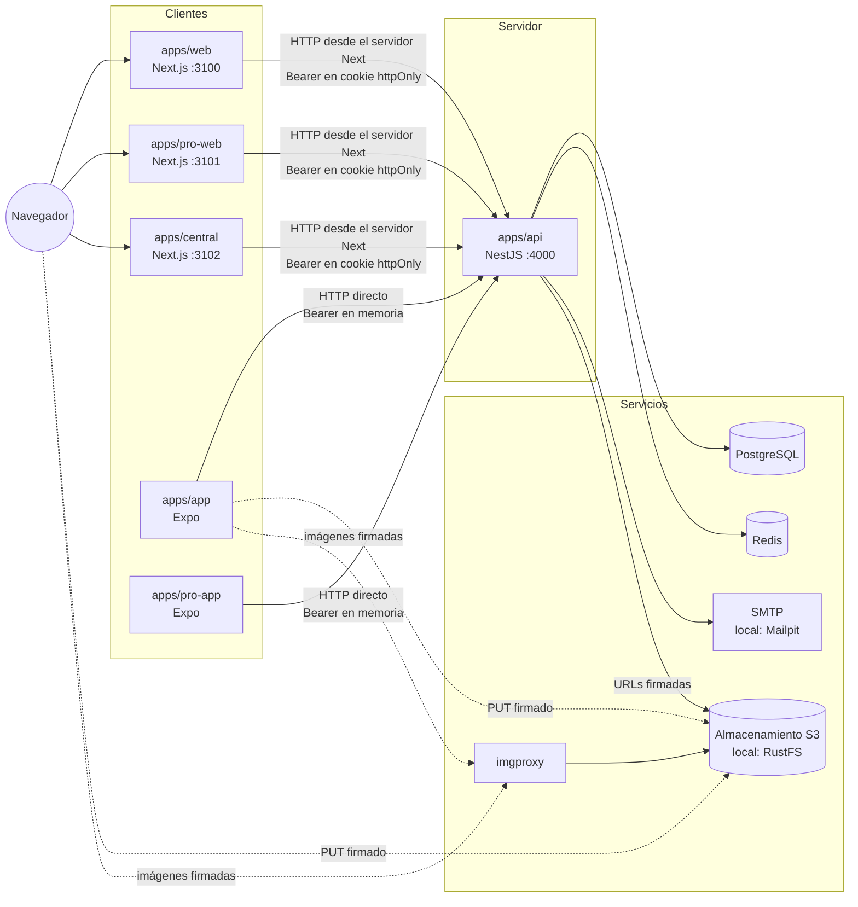
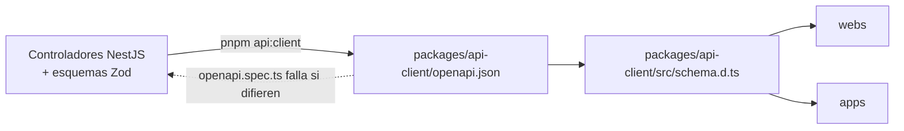
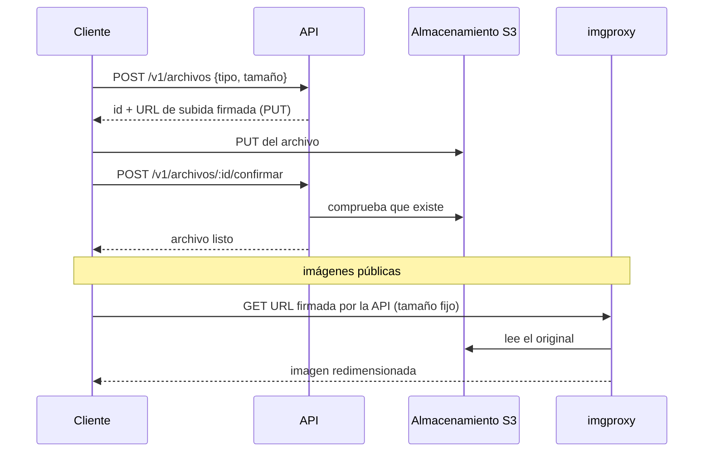
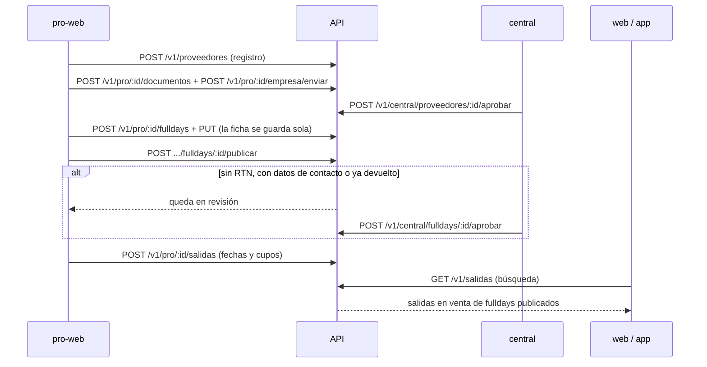
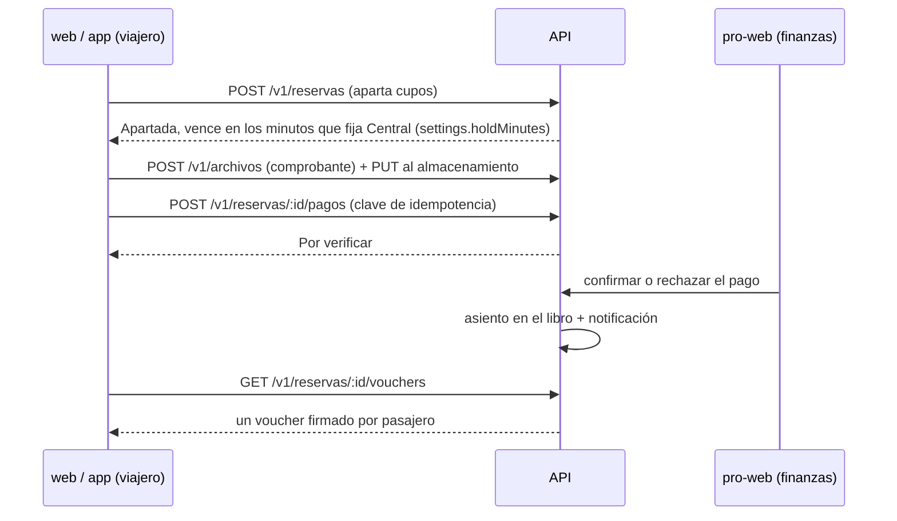

# Integración entre subproyectos

Cómo se comunican las piezas del monorepo: quién llama a quién, con qué credenciales, dónde viven los datos y qué corre en segundo plano. El detalle de cada pieza está en su documento: [API](api.md), [webs](webs.md), [apps móviles y worker](apps-moviles.md) y [paquetes compartidos](paquetes.md).

## Topología



Reglas que no cambian entre pantallas:

- **Solo la API toca la base de datos, Redis, el correo y el almacenamiento con credenciales.** Ninguna web ni app tiene acceso directo a esos servicios.
- **Las webs llaman a la API desde su servidor**, nunca desde el navegador: el token vive en una cookie `httpOnly` que el JavaScript de la página no puede leer (`packages/web-session/src/session.ts`). Por eso la API no necesita CORS para las webs.
- **Las apps llaman a la API directo** desde el dispositivo. La API las admite por CORS solo en sus vistas previas web (`CORS_ORIGINS`, `apps/api/src/app.setup.ts`); las apps nativas no envían origen.
- **Los archivos no pasan por la API.** La API firma una URL y el cliente sube o descarga directo del almacenamiento.
- **Todas las piezas comparten reglas**, no copias: validación, precios, estados y permisos viven en `packages/shared` y los usan por igual la API, las webs y las apps.

## Contrato entre la API y los clientes



- El contrato OpenAPI se genera del código (`apps/api/src/write-openapi.ts`) y se guarda en el repositorio. Una prueba de la API (`apps/api/src/openapi.spec.ts`) falla si el código y el archivo guardado no coinciden: un cambio de endpoint obliga a regenerar el cliente en el mismo commit.
- Los clientes usan el cliente tipado de `@salimos/api-client` (sobre `openapi-fetch`): una ruta o un cuerpo mal escritos no compilan.
- Todas las rutas van bajo `/v1`. Los errores tienen una sola forma: `statusCode`, `code`, `message` y, en validación, `issues` por campo (`apps/api/src/common/api-error.ts`). Los clientes deciden por `code`, nunca por el texto.

Zonas del contrato y quién las usa:

| Prefijo                                                                                                          | Para                                    | Clientes                                                             |
| ---------------------------------------------------------------------------------------------------------------- | --------------------------------------- | -------------------------------------------------------------------- |
| `/v1/auth/*`                                                                                                     | Cuentas y sesiones                      | Todos                                                                |
| `/v1/salidas`, `/v1/fulldays/*`, `/v1/agencias/*`, `/v1/tematicas`, `/v1/catalogos/*`, `/v1/tasa`, `/v1/ajustes` | Catálogo y ajustes públicos, sin sesión | `web`, `app`, `pro-web` y `central` (catálogos, temáticas y ajustes) |
| `/v1/yo/*`, `/v1/reservas/*`, `/v1/reclamos/*`, `/v1/vouchers/*`                                                 | El viajero con sesión                   | `web`, `app`                                                         |
| `/v1/archivos/*`                                                                                                 | Subir y leer archivos                   | `web`, `app`, `pro-web`                                              |
| `/v1/proveedores` y `/v1/pro/:providerId/*`                                                                      | Una agencia y su equipo                 | `pro-web`, `pro-app`                                                 |
| `/v1/central/*`                                                                                                  | Equipo interno                          | `central`                                                            |
| `/salud`                                                                                                         | Monitoreo                               | Infraestructura                                                      |

## Identidad, sesiones y permisos

### Una sola cuenta para todo

Una cuenta (`users`) se identifica por su correo. La misma cuenta puede ser viajera, pertenecer a una o varias agencias (`provider_members`, un rol por agencia) y estar en el equipo interno (`staff_members`, varios roles). No hay cuentas separadas por aplicación: lo que ve cada aplicación sale de `GET /v1/yo`, que devuelve las membresías y los permisos calculados.

```mermaid
sequenceDiagram
  participant C as Cliente (web o app)
  participant A as API
  participant R as Redis
  participant M as Correo
  C->>A: POST /v1/auth/registrar {email, password}
  A->>R: guarda el código (hash con secreto, 5 min, 5 intentos)
  A->>M: envía el código
  C->>A: POST /v1/auth/verificar {email, code}
  A-->>C: accessToken (JWT 15 min) + refreshToken (60 días)
  C->>A: GET /v1/yo (Bearer)
  A-->>C: usuario, membresías, permisos
  Note over C,A: al vencer el acceso
  C->>A: POST /v1/auth/renovar {refreshToken}
  A-->>C: par nuevo; el anterior queda reemplazado
```

- **Token de acceso**: JWT HS256 firmado con `JWT_SECRET`, 15 minutos (`apps/api/src/auth/token.service.ts`). Lleva el usuario y la sesión.
- **Token de renovación**: aleatorio, se guarda solo su hash en `sessions`. Cada renovación lo rota; repetir la misma renovación en el minuto siguiente devuelve el mismo par (reintentos y pestañas paralelas). Presentar uno ya rotado después de ese minuto cierra la sesión entera (`apps/api/src/auth/session.service.ts`).
- **Dónde vive cada token**: en las webs, dos cookies `httpOnly`, `SameSite=Lax` (`salimos_access`, `salimos_refresh`) que maneja el servidor Next; en las apps, el de acceso en memoria y el de renovación en el almacenamiento cifrado del dispositivo (`packages/app-session/src/store.ts`).
- **Bloqueo**: Central puede bloquear una cuenta; eso revoca todas sus sesiones y la API rechaza sus entradas.

### Permisos por dirección

La API decide el acceso por la zona de la ruta, no por la pantalla que la llama (`apps/api/src/access/`):

- `/v1/pro/:providerId/*` exige que la cuenta pertenezca a esa agencia y que su rol tenga el permiso que declara el endpoint con `@Can(...)`. Además entrega una conexión a la base que solo ve filas de esa agencia (`@ScopedDb()`, `packages/db/src/scope.ts`).
- `/v1/central/*` exige estar en el equipo interno con el permiso del endpoint.
- Un endpoint en esas zonas sin permiso declarado responde 403 a todos.

Las webs y apps esconden lo que el rol no puede hacer, pero la decisión real es siempre de la API. La tabla de permisos por rol está en `packages/shared/src/access.ts` y la usan ambos lados.

### Auditoría

Cada acción que cambia algo en `/v1/pro/*` o `/v1/central/*` deja una fila en `audit_log` con quién, dónde, la entrada y el antes y el después (`apps/api/src/audit/`). Una prueba (`apps/api/src/audit/audit.spec.ts`) falla si un endpoint de esas zonas que cambia datos no tiene su prueba de auditoría.

## Datos

- **Una sola base PostgreSQL** con un solo esquema Prisma (`packages/db/prisma/schema.prisma`). Tablas y relaciones: [modelo de datos](../arquitectura/modelo-de-datos.md).
- **Aislamiento por agencia**: las tablas con `providerId` están listadas en `PROVIDER_OWNED_MODELS` y el cliente acotado les agrega el filtro solo. Una tabla nueva con `providerId` que no se agregue ahí queda sin aislar; la lista es la defensa.
- **La ficha de un fullday es un documento** (`fulldays.sheet`, JSON validado con `FulldaySheetSchema`). Cada salida guarda una copia de la ficha con la que se vende (`departures.sheet`) y columnas de búsqueda derivadas de ella (`apps/api/src/departures/facets.ts`).
- **Cupos atómicos**: apartar descuenta con un `UPDATE` condicional sobre `departures.reserved` y sobre `departure_quotas` (platos y habitaciones), con restricciones `CHECK` que impiden pasar del cupo. No hay bloqueo en memoria: dos apartados simultáneos no pueden vender el mismo asiento.
- **Dinero**: los pagos confirmados y los reembolsos pagados se asientan en un libro de doble partida (`ledger_entries`, `apps/api/src/payments/ledger.ts`). Liquidaciones y métricas se leen de ese libro, nunca se guardan aparte.
- **Redis** guarda solo estado efímero: códigos de un solo uso, contadores de intentos, límites de peticiones y las marcas `revoked:<sesión>` que invalidan al instante los tokens de acceso de una sesión cerrada (`apps/api/src/auth/session.service.ts`). Perderlo no pierde datos de negocio, pero sí esas marcas: los tokens de acceso de sesiones ya cerradas seguirían valiendo hasta sus 15 minutos.

## Archivos e imágenes



- Dos depósitos: imágenes (fotos de fullday) y documentos (RIF, cédulas, comprobantes de pago). Los documentos solo se leen con URLs firmadas de corta vida que la API entrega a quien tiene permiso (`apps/api/src/files/storage.service.ts`).
- Las imágenes se sirven por imgproxy con URLs firmadas (`IMGPROXY_KEY`, `IMGPROXY_SALT`) y solo en los tamaños permitidos.
- El depósito acepta `PUT` del navegador solo desde los orígenes de `CORS_ORIGINS`; en local lo configura `pnpm storage:init`.

## Procesos en segundo plano

No hay cola externa. Hoy todo corre dentro del proceso de la API con temporizadores que arrancan al iniciar el módulo, cada `EXPIRE_HOLDS_EVERY_SECONDS` (60 por defecto; 0 los apaga, como en las pruebas):

| Proceso             | Dónde                                                                                           | Qué hace                                                                          |
| ------------------- | ----------------------------------------------------------------------------------------------- | --------------------------------------------------------------------------------- |
| Vencer apartados    | `BookingsService.expireHolds` (`apps/api/src/bookings/bookings.service.ts`)                     | Las reservas apartadas sin pago reportado pasan a expiradas y devuelven sus cupos |
| Saldos vencidos     | `BookingsService.cancelOverdueBalances`                                                         | Las reservas abonadas cuyo saldo venció se cancelan                               |
| Recordatorios       | `NotificationsService.enqueueReminders` (`apps/api/src/notifications/notifications.service.ts`) | Encola recordatorios de saldo y de salida, sin duplicar                           |
| Entrega de mensajes | `NotificationsService.deliverPending`                                                           | Envía los mensajes pendientes con reintentos                                      |

`apps/worker` existe pero está vacío: ver [apps móviles y worker](apps-moviles.md).

**Todavía no:** con más de una instancia de la API, dos podrían tomar el mismo mensaje y enviarlo dos veces; el propio código lo advierte y pide mover el ciclo al worker antes de escalar.

### Mensajes a las personas

Los cambios que interesan al viajero o a la agencia (pago confirmado o rechazado, salida cancelada, avisos de la agencia, recordatorios) se escriben como filas en `notifications`, una por canal, justo **después** de que la operación de negocio se confirma (por ejemplo `apps/api/src/payments/payments.service.ts`, en `confirm`, `reject` y `payRefund`). El ciclo de entrega las envía más tarde. Así un fallo del proveedor nunca deshace la operación de negocio; a cambio, si el proceso cae entre el commit y el encolado, el cambio queda hecho y el aviso se pierde.

**Todavía no:** el único emisor es `LogNotificationSender`, que solo escribe en la salida de la API (`NOTIFICATION_SENDER=log`, prohibido en producción). Push y WhatsApp esperan sus cuentas. Tampoco hay un endpoint para que la persona lea sus notificaciones: lo único que webs y apps muestran son los avisos de cada salida (`GET /v1/reservas/{id}/avisos`).

### Correo

Los códigos de confirmación y de recuperación salen por el emisor que fija `OTP_SENDER`: `log` (por defecto) los imprime en la salida de la API; `smtp` los envía por `SMTP_URL`, y en local llegan a Mailpit (http://localhost:8025). **Todavía no:** falta el servicio SMTP de producción.

## Recorridos que cruzan aplicaciones

### Del borrador a la venta



### Reserva y pago



La agencia también puede vender por fuera desde `pro-web`: entra por el mismo servicio de reservas y descuenta los mismos cupos.

### El día del viaje

```mermaid
sequenceDiagram
  participant G as pro-app (guía o dueño)
  participant A as API
  participant P as pro-web
  P->>A: iniciar la salida
  G->>A: GET lista de la salida + llaves públicas de vouchers
  Note over G: sin señal: valida firmas y marca en el teléfono
  G->>A: POST marcas (sincroniza; gana la más reciente)
  P->>A: finalizar la salida
  A->>A: reservas a Completada o No se presentó
```

Los vouchers se firman con Ed25519 (`VOUCHER_SIGNING_KEY`) y el teléfono los verifica sin conexión con las llaves públicas que descargó (`packages/shared/src/voucher.ts`). Las llaves retiradas (`VOUCHER_RETIRED_PUBLIC_KEYS`) siguen validando vouchers ya emitidos.

**Todavía no:** no hay pantalla para asignar guías a una salida; hoy pasa lista el dueño.

### Después del viaje

- **Cancelación**: el viajero ve el reembolso calculado por `refundFor` (`packages/shared/src/booking.ts`) antes de cancelar; al cancelar, la API crea el reembolso a cargo de la agencia; la agencia lo marca pagado en `pro-web` y el libro lo asienta.
- **Reseña**: solo una reserva Completada, una vez, hasta 30 días después. Calcula la reputación del fullday y de la agencia; una reseña con datos de contacto queda oculta hasta que Central la mira.
- **Reclamo**: viajero y agencia conversan; el viajero lo escala; Central escribe la decisión y lo cierra. La decisión no mueve dinero.

## Configuración compartida

| Variable                                                                                 | La leen                  | Para                                                                           |
| ---------------------------------------------------------------------------------------- | ------------------------ | ------------------------------------------------------------------------------ |
| `API_URL`                                                                                | Las tres webs (servidor) | Dirección de la API                                                            |
| `EXPO_PUBLIC_API_URL`                                                                    | Las dos apps             | Dirección de la API desde el dispositivo (por defecto `http://localhost:4000`) |
| `GOOGLE_CLIENT_ID`                                                                       | Las tres webs            | Muestra el botón de Google                                                     |
| `GOOGLE_CLIENT_IDS`                                                                      | API                      | Clientes de Google aceptados                                                   |
| `CORS_ORIGINS`                                                                           | API y almacenamiento     | Orígenes que pueden llamar desde el navegador y subir archivos                 |
| `DATABASE_URL`, `REDIS_URL`, `S3_*`, `IMGPROXY_*`, `SMTP_URL`, `JWT_SECRET`, `VOUCHER_*` | API                      | Servicios y secretos                                                           |

La lista completa de la API, con sus valores por defecto y cuáles se rechazan en producción, está en [api.md](api.md). Entornos y puertos: [entornos.md](../arquitectura/entornos.md).

## Cómo se prueba la integración

- **API contra servicios reales**: las pruebas de `apps/api` corren contra PostgreSQL y Redis de verdad, en una base y un número de Redis separados (`apps/api/src/testing/prepare.ts`).
- **De punta a punta**: Playwright (`playwright.config.ts`, `e2e/`) levanta la API compilada, las tres webs y las vistas previas web de las dos apps, y recorre los flujos entre aplicaciones (registrar y aprobar una agencia, reservar y pagar, pasar lista, cancelar y reclamar).
- **Un solo punto de verificación**: `./scripts/verificar.sh` ([verificacion.md](../proceso/verificacion.md)).
