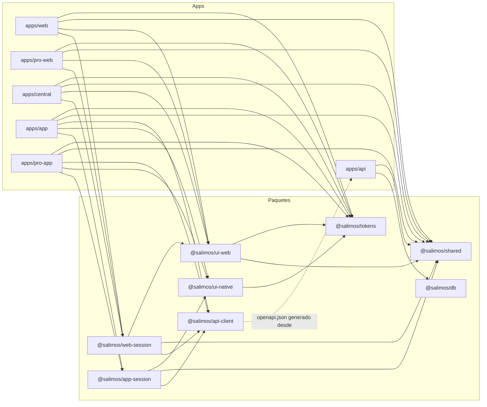

# Paquetes compartidos y herramientas del workspace

Este documento describe, desde el código actual, cada paquete de `packages/` y las herramientas del monorepo (scripts raíz, Turborepo, pnpm, `scripts/` y la suite e2e). Para el resto de subproyectos:

- API: [api.md](api.md) · Webs: [webs.md](webs.md) · Apps móviles: [apps-moviles.md](apps-moviles.md) · Cómo se integran: [integracion.md](integracion.md) · Índice: [README.md](README.md).
- Arquitectura: [modelo de datos](../arquitectura/modelo-de-datos.md), [API](../arquitectura/api.md), [seguridad](../arquitectura/seguridad.md), [entornos](../arquitectura/entornos.md).
- Decisión de stack: [2026-11-02-salimos.md](../stack/2026-11-02-salimos.md). Verificación: [verificacion.md](../proceso/verificacion.md).

## Resumen

| Paquete                | Qué es                                                                                       | Salida                               | Pruebas                            |
| ---------------------- | -------------------------------------------------------------------------------------------- | ------------------------------------ | ---------------------------------- |
| `@salimos/config`      | `tsconfig` base de TypeScript                                                                | Ninguna (solo JSON)                  | —                                  |
| `@salimos/shared`      | Reglas de dominio y esquemas Zod comunes a API, webs y apps                                  | `dist/` (compilado con `tsc`)        | `node --test`                      |
| `@salimos/db`          | Esquema Prisma, migraciones, cliente generado y cliente limitado a un proveedor              | `dist/` (`prisma generate && tsc`)   | `node --test`                      |
| `@salimos/api-client`  | Contrato OpenAPI y cliente HTTP tipado                                                       | Fuente (`src/index.ts`)              | `openapi-typescript --check`       |
| `@salimos/web-session` | Sesión de las webs Next.js: cookies, acciones de inicio de sesión y proxy de renovación      | Fuente (`src/*.ts`)                  | Sin pruebas propias (cubierto e2e) |
| `@salimos/app-session` | Sesión de las apps Expo, puerta de autenticación, check-in sin señal y caché del dispositivo | Fuente (`src/index.ts`)              | `node --test`                      |
| `@salimos/tokens`      | Fuente única de tokens de diseño y generador de CSS                                          | Fuente + CSS generado y versionado   | `node --test`                      |
| `@salimos/ui-web`      | Componentes React para las tres webs y tema Tailwind por producto                            | Fuente (`src/index.ts`, `theme.css`) | Sin pruebas propias (cubierto e2e) |
| `@salimos/ui-native`   | Componentes React Native para las dos apps                                                   | Fuente (`src/index.ts`)              | `jest` (preset `jest-expo`)        |

Dos formas de publicar un paquete dentro del workspace:

- **Compilados** (`shared`, `db`): `package.json` exporta `./dist/index.js` y `./dist/index.d.ts`. Turborepo los construye antes que sus consumidores (`"dependsOn": ["^build"]` en `turbo.json`). Sus `tsconfig.json` usan `rewriteRelativeImportExtensions` para que los imports `./x.ts` del código fuente queden como `./x.js` en `dist/`, y excluyen `src/**/*.test.ts`.
- **Fuente** (el resto): `package.json` exporta archivos `.ts`/`.tsx` y cada consumidor los transpila. Las webs los declaran en `transpilePackages` (`apps/web/next.config.ts:20`, igual en `apps/pro-web` y `apps/central`: `@salimos/ui-web`, `@salimos/web-session`, `@salimos/api-client`); las apps Expo los empaquetan con Metro.

## Grafo de dependencias

Dependencias declaradas en cada `package.json` (`workspace:*`). `@salimos/config` se omite: lo usan como `devDependency` casi todos los paquetes y las webs, solo para extender `tsconfig.base.json`.



`apps/worker` solo depende de `@salimos/config` (es un marcador; ver [Workspace](#workspace-y-herramientas)). `api-client` no depende de la API en tiempo de ejecución: su contrato `openapi.json` se genera a partir de ella (línea punteada).

Consumidores reales, contando archivos que importan cada paquete (búsqueda de `@salimos/<paquete>` en `apps/` y `packages/`, sin `node_modules`, `dist` ni `.next`):

| Paquete       | Importado desde                                                                                                                                                                                                 |
| ------------- | --------------------------------------------------------------------------------------------------------------------------------------------------------------------------------------------------------------- |
| `shared`      | `apps/api` (38), `apps/pro-web` (19), `apps/central` (15), `apps/web` (10), `apps/app` (3), `packages/app-session` (3), `packages/ui-web` (3), `packages/web-session` (1), `packages/ui-native` (1, comentario) |
| `db`          | `apps/api` (47)                                                                                                                                                                                                 |
| `api-client`  | `apps/app` (3), `apps/pro-app`, `apps/web`, `apps/pro-web`, `apps/central` (1 cada una, `next.config.ts` en las webs), `packages/app-session` (2), `packages/web-session` (1)                                   |
| `web-session` | `apps/central` (28), `apps/pro-web` (24), `apps/web` (15)                                                                                                                                                       |
| `app-session` | `apps/app` (4), `apps/pro-app` (2)                                                                                                                                                                              |
| `tokens`      | `packages/ui-native` (12), `apps/app` (2), `apps/web` (2), `apps/pro-web` (2), `apps/pro-app` (1), `packages/ui-web` (1, `theme.css`)                                                                           |
| `ui-web`      | `apps/central` (29), `apps/pro-web` (24), `apps/web` (15), `packages/web-session` (1, tipo `SignInState`)                                                                                                       |
| `ui-native`   | `apps/app` (4), `apps/pro-app` (2), `packages/app-session` (1)                                                                                                                                                  |

## `@salimos/config`

`packages/config/tsconfig.base.json` es lo único que exporta (`"./tsconfig.base.json"`). Fija para todo el monorepo: `strict`, `noUncheckedIndexedAccess`, `noImplicitOverride`, `isolatedModules`, `esModuleInterop`, `skipLibCheck` y `resolveJsonModule`. Cada paquete añade su `target`, `module` y `moduleResolution`:

- Paquetes de Node compilados (`shared`, `db`): `ES2023`, `module: nodenext`, `outDir: dist`, `declaration: true`.
- Paquetes de navegador o Next (`api-client`, `ui-web`, `web-session`): `ES2022`, `module: esnext`, `moduleResolution: bundler`, `noEmit`.
- Paquetes de React Native (`app-session`, `ui-native`) extienden `expo/tsconfig.base` en lugar de este archivo (`packages/app-session/tsconfig.json`).

## `@salimos/shared`

Validación y reglas de negocio que la API, las webs y las apps comparten, para que nunca discrepen. Todo es TypeScript puro sin APIs de plataforma: corre igual en Node, el navegador y React Native. Dependencias: `zod`, `@noble/curves` (firma Ed25519) y `qrcode-generator`.

- Punto de entrada: `packages/shared/src/index.ts`. Salida: `dist/` con `tsc` (`pnpm --filter @salimos/shared build`; `dev` lo ejecuta en modo `--watch`).
- Pruebas: `node --test` sobre `src/*.test.ts` (Node 24 ejecuta TypeScript directamente): `fullday.test.ts`, `departure.test.ts`, `search.test.ts`, `booking.test.ts`, `voucher.test.ts`, `access.test.ts`, `shared.test.ts` (teléfonos, códigos, cédulas, RIF, pasajeros, registro de agencias).

### Ficha del fullday (`src/fullday.ts`)

Todo lo que una agencia declara sobre un viaje y la regla que decide si se puede publicar.

- **Catálogos de etiquetas** (`clave → texto en español`): `FULLDAY_STATUS_LABELS`, `FULLDAY_TAGS`, `FULLDAY_CATEGORIES`, `DURATION_TYPES`, `VEHICLES`, `AMENITIES`, `MEAL_MOMENTS`, `MEAL_MODES` (`fixed`, `choice`, `optional`, `not_included`), `ITEM_TYPES` (`hydration`, `shade`, `access`, `service`, `activity`), `ITEM_MODALITIES` (`included`, `optional`, `pay_at_destination`, `not_included`), `ROOM_TYPES`, `LODGING_REGIMES`, `PASSENGER_TYPES` (`adult`, `child`, `senior`, `infant`) y `CANCELLATION_TEMPLATES` (`flexible`, `moderate`, `strict`). Las claves se convierten en `z.enum` con el helper interno `keys()`, así que añadir una etiqueta amplía el esquema.
- **`FulldaySheetSchema`** y su tipo `FulldaySheet`. Objeto estricto (`z.strictObject`: rechaza campos desconocidos) con bloques `general`, `itinerary`, `transfer` (`legs`, `boardingPoints`), `meals`, `items`, `noAccessFees`, `lodging`, `whatToBring` y `pricing` (`fares`, `deposit`, `balanceDueDaysBefore`, `cancellation`). Casi todo es opcional o tiene `default`: un borrador se guarda a medias. Reglas propias del esquema:
  - Ids en UUID; fotos (`photoIds`) son ids de archivos subidos por `/v1/archivos`, máximo 20.
  - Horas en formato `HH:MM`.
  - `nights <= days`, y hay noches si y solo si `durationType === 'multi_day'`.
  - El abono (`deposit`) es una unión discriminada: `percent` (1–100) o `amount` en USD.
  - Los suplementos del punto de embarque (`priceDeltaUsd`) admiten negativos (−1000 a 1000).
- **`completeness(sheet)`** devuelve `{ percent, publishable, missing, blocks }`. Recorre una lista de comprobaciones por bloque (datos generales, itinerario, traslado, comidas, hidratación, toldos, alojamiento, accesos, qué llevar, precios) y calcula el porcentaje por bloque y global (redondeo hacia abajo). `publishable` es `true` solo si no falta nada. Reglas relevantes:
  - Al menos `MIN_PHOTOS` (5) fotos; un itinerario con hitos por cada día; al menos un tramo de traslado; todos los puntos de embarque con hora de salida y de regreso.
  - Al menos una comida por día; cada comida se comprueba según su modo (fija: qué se sirve; opcional: qué y precio; a escoger: dos opciones o más, cuántas escoge cada pasajero, cantidad o ilimitada por opción y exactamente una opción por defecto).
  - Hidratación y toldos deben declararse siempre (aunque sea como «no incluido»).
  - Alojamiento (nombre, régimen, al menos un tipo de habitación) solo se exige cuando hay noches.
  - Accesos declarados o `noAccessFees: true`; cada acceso que se paga en destino necesita monto y forma de pago.
  - Precio de adulto mayor que cero, abono, fecha límite del saldo y política de cancelación (plantilla o texto propio).
- **`inclusions(sheet)`**: la ficha como la lee el viajero, siempre en cuatro grupos: `included`, `optional`, `payAtDestination`, `notIncluded`.
- **`cashAtDestination(sheet)`**: suma en USD de lo que se paga en destino y la lista de conceptos.
- **`contactInfo(value)`**: recorre cualquier valor (recursivo) y devuelve teléfonos venezolanos y enlaces de WhatsApp escritos en los textos. Ignora cadenas que empiezan como UUID. La API lo usa para mandar a revisión de Central una ficha con datos de contacto, porque las reservas deben quedarse dentro de la plataforma.

### Salidas (`src/departure.ts`)

- `DEPARTURE_STATUS_LABELS` / `DEPARTURE_STATUSES`: `open`, `paused`, `closed`, `in_progress`, `finished`, `cancelled`.
- `ScheduleDeparturesSchema` (tipo `ScheduleDepartures`): programa una o varias fechas (`YYYY-MM-DD`, sin repetir, máximo `MAX_DEPARTURES_PER_REQUEST` = 60) de un fullday con el mismo cupo (1–1000), mínimo para salir (`minCapacity`, por defecto 1, nunca mayor que el cupo) y precio de adulto opcional por temporada.
- `DepartureUpdateSchema`: cambia cupo, mínimo, precio (`null` vuelve al precio de la ficha), estado y guías asignados (`guideIds`, hasta 10).
- `weeklyDates(from, until)`: el mismo día de la semana entre dos fechas, con el mismo tope de 60.
- `seatsLeft({ capacity, reserved })`: puestos libres, nunca negativos.
- `todayInVenezuela(now?)`: día calendario en UTC−4 (Venezuela no tiene horario de verano).
- `canMoveDeparture(from, to)`: máquina de estados. Mientras vende se mueve libremente entre `open`, `paused` y `closed`; de ahí puede pasar a `in_progress` o `cancelled`; `in_progress` solo va a `finished`; `finished` y `cancelled` son finales.

### Búsqueda (`src/search.ts`)

- `INCLUDES`: hechos filtrables de lo que incluye el precio (`breakfast`, `lunch`, `dinner`, `meal_choice`, `hydration`, `shade`, `access`, `lodging`).
- `SEARCH_ORDERS` (`recomendados`, `precio`, `fecha`, `cupos`) y `SEARCH_PAGE_SIZE` = 20.
- `normalizeText(text)`: minúsculas, sin acentos (NFD sin diacríticos) y espacios simples. Así se guarda y compara el texto de búsqueda.
- `searchFacets(sheet)`: los hechos de una ficha que la API guarda junto a cada salida: categoría, tipo de duración, destino, edad mínima, precio de adulto, etiquetas ordenadas, `includes` ordenados y `text` normalizado (título + descripción corta). Una comida cuenta como incluida si es `fixed` o `choice`; un ítem, si su modalidad es `included`; el alojamiento, si hay noches y nombre.
- `SearchQuerySchema` (tipo `SearchQuery`) y `SEARCH_QUERY_KEYS`: los filtros tal como viajan en la URL, todos texto: `q`, `desde`, `fechaDesde`, `fechaHasta`, `destino`, `categoria`, `tematica`, `duracion`, `precioMax`, `incluye` (lista separada por comas), `verificados`, `ninos`, `mascotas` (`'1'` o `'true'`), `orden` (por defecto `recomendados`) y `pagina` (1–500). Un campo vacío del formulario equivale a filtro no puesto, y los filtros no puestos se eliminan del resultado. La web y la app construyen la misma consulta.
- `bolivares(usd, bsPerUsd)`: referencia en bolívares con formato `es-VE` y dos decimales.

### Reserva, pagos, reseñas y reclamos (`src/booking.ts`)

- **Estados** `BOOKING_STATUS_LABELS` / `BOOKING_STATUSES`: `held`, `in_review`, `deposit_paid`, `paid`, `expired`, `cancelled`, `completed`, `no_show`. `SEAT_HOLDING_STATUSES` son los que retienen puestos: `held`, `in_review`, `deposit_paid`, `paid`.
- **`nextBookingStatus(status, event)`**: máquina de estados con eventos `BookingEvent` (`submit_proof`, `confirm_payment` con `paidUsd`/`depositUsd`/`totalUsd`, `reject_proof`, `expire`, `balance_overdue`, `finish` con `boarded`, `cancel`). Devuelve `null` si el evento no aplica. Al confirmar un pago se pasa a `paid` si se cubrió el total, a `deposit_paid` si se cubrió el abono y, si no, se queda (desde `in_review`, un pago menor que el abono vuelve a `held`). `finish` lleva a `completed` o `no_show` según hubo abordaje. `expired` y `cancelled` nunca regresan.
- **`BookingSelectionSchema`** (tipo `BookingSelection`): lo que elige el viajero antes de pagar: punto de embarque, de 1 a 30 pasajeros por tipo con sus opciones de comida a escoger (omitidas: escoge luego), tipo de habitación y extras con cantidad.
- **`checkSelection(sheet, selection)`**: lista de problemas en palabras para el viajero (vacía si todo está bien): punto de embarque de este fullday, al menos un adulto o adulto mayor, habitación cuando hay noches, opciones de comida existentes y en el número exacto `picksPerPassenger`, extras válidos (solo ítems y comidas opcionales).
- **`demand(sheet, selection)`**: lo que la selección toma de cada cupo de la salida: puestos (los infantes no ocupan), punto de embarque, porciones por opción de comida y habitaciones (`ceil(puestos / ocupación)`; la ocupación de `shared` y `camping` es 1 porque se venden por plaza).
- **`quote(sheet, selection, departure)`** (tipo `Quote`): precio línea a línea en USD: tarifas por tipo de pasajero (el precio de adulto de la salida sustituye al de la ficha; un tipo sin tarifa paga como adulto), suplemento del embarque, recargos de comida, extras y habitación. Devuelve `totalUsd`, `depositUsd` (porcentaje del total, o monto fijo por puesto, o el total si no hay abono declarado; nunca mayor que el total), `balanceUsd`, `balanceDueDate` (fecha de la salida menos `balanceDueDaysBefore`) y `cashAtDestinationUsd` (lo que el grupo lleva en efectivo, nunca sumado al total). Redondea a centavos. El mismo cálculo corre en el formulario web (`packages/ui-web/src/booking-form.tsx`) y en la API, de modo que lo mostrado es lo cobrado.
- **Pagos**: `PAYMENT_METHOD_LABELS` (`mobile_payment`, `bank_transfer`, `zelle`, `cash`), `TRAVELER_PAYMENT_METHODS` (los tres primeros; el efectivo es solo para ventas propias de la agencia), `BOLIVAR_METHODS` (llevan la tasa del día), `PAYMENT_STATUS_LABELS`. `ReportPaymentSchema` (tipo `ReportPayment`): método, referencia normalizada (sin espacios ni guiones, en mayúsculas, 4–40), monto, comprobante opcional (archivo subido) e `idempotencyKey` (8–80) que la app genera por intento para que un reintento en mala red no pague dos veces.
- **`refundFor({ template, by, daysBefore, paidUsd, depositUsd })`** devuelve `{ refundUsd, rule }`:
  - Sin pagos confirmados: 0.
  - Cancela la agencia: se devuelve todo lo pagado.
  - `flexible`: total si faltan 2 días o más; si no, 0.
  - `moderate`: total desde 7 días; la mitad entre 2 y 6 días; 0 con menos de 2.
  - `strict`: lo pagado menos el abono desde 7 días; 0 con menos.
  - Sin plantilla (política propia): 0, se acuerda con la agencia.
- **Reseñas y reclamos**: `REVIEW_ASPECTS`, `FULFILLED_LABELS`, `REVIEW_WINDOW_DAYS` = 30, `ReviewInputSchema` (tipo `ReviewInput`: estrellas 1–5, aspectos opcionales, si se cumplió lo de la ficha y comentario de 10 a 1000 caracteres) y `CLAIM_STATUS_LABELS` (`open`, `escalated`, `resolved`).

### Vouchers firmados (`src/voucher.ts`)

El voucher con el que aborda un pasajero es un texto corto firmado con Ed25519 y llevado en un QR. El teléfono del guía lo verifica con la clave pública, sin red.

- `signVoucher(payload, secretHex)`: solo la API tiene la clave (`VOUCHER_SIGNING_KEY` en `apps/api/src/config.ts`). El cuerpo es `idClave:código:pasajero:salida:fecha` con los UUID empaquetados en base64url (sin JSON) para que el QR tenga pocos módulos grandes; la firma va detrás de un punto.
- `voucherPublicKey(secretHex)` (base64url, publicable) y `voucherKeyId(secretHex)` (sus primeros 8 caracteres, viaja en cada voucher).
- `verifyVoucher(token, publicKeys, { departureId, today })` devuelve `{ ok: true, payload }` o `{ ok: false, reason }`. Rechaza formato inválido, firma inválida, otra salida y vouchers vencidos (vale el día del viaje y el siguiente, para viajes que regresan pasada la medianoche). Si el id de clave no está entre las del dispositivo, pide actualizar la lista de pasajeros.
- Tipo `VoucherPayload`: `code`, `passengerId`, `departureId`, `date`.

### QR (`src/qr.ts`)

`qrMatrix(text)`: matriz de booleanos (módulo oscuro = `true`) con corrección de errores media. Cada plataforma la dibuja a su manera: SVG en `packages/ui-web/src/qr-code.tsx`, vistas en `packages/ui-native/src/qr-code.tsx`. Sin imágenes ni red.

### Roles y permisos (`src/access.ts`)

- Proveedores: `PROVIDER_ROLES` (`owner`, `operations`, `finance`, `guide`), `PROVIDER_PERMISSIONS` (`team`, `company`, `fulldays`, `departures`, `bookings`, `notices`, `payments`, `settlements`, `reports`, `checkin`), `providerPermissions(role)` y `PROVIDER_ROLE_LABELS`. `owner` tiene todos; `operations`: fulldays, salidas, reservas, avisos; `finance`: pagos, liquidaciones, reportes; `guide`: check-in y avisos.
- Central: `STAFF_ROLES` (`super`, `support`, `moderation`, `content`, `finance`), `STAFF_PERMISSIONS` (18 permisos, de `staff` a `metrics`), `staffPermissions(roles)` (una persona puede tener varios roles: los permisos se suman sin duplicar) y `STAFF_ROLE_LABELS`. `super` tiene todos, incluidos `staff`, `audit`, `providers` y `settings`, que nadie más tiene.
- La API los hace cumplir en `apps/api/src/access/access.guard.ts`; las webs y apps los leen para ocultar lo que la persona no puede usar.

### Identidad y personas (`src/identity.ts`, `src/phone.ts`, `src/people.ts`, `src/providers.ts`)

- `EmailSchema`: recorta y pasa a minúsculas antes de validar (máximo 254), así `Ana@x.com` y `ana@x.com` son la misma cuenta.
- `PasswordSchema`: 8 a 128 caracteres.
- `OtpCodeSchema`: exactamente 6 dígitos.
- `CedulaSchema`: normaliza a `V-12345678` (`V` o `E`, 6–9 dígitos; sin letra se asume `V`).
- `RifSchema`: normaliza a `J-12345678-9` (letras `J G V E P C`).
- `PhoneSchema`: normaliza a E.164 (`0412…`, `58412…`, `00…`); los números venezolanos deben ser celulares de los prefijos 412, 414, 416, 422, 424 o 426; los extranjeros necesitan prefijo internacional.
- `ProfileUpdateSchema` (nombre y teléfono; el correo no se cambia aquí) y `PassengerInputSchema` (pasajero frecuente: nombre, cédula opcional, fecha de nacimiento real, no futura y de menos de 120 años, restricciones hasta 300 caracteres).
- `ProviderInputSchema` (registro de agencia u organizador: tipo, nombre, razón social, RIF, RTN opcional, ciudad base, teléfono, usuario de Instagram sin `@` e instrucciones de pago opcionales), `PROVIDER_DOCUMENT_TYPES`, `PROVIDER_DOCUMENT_LABELS`, `REQUIRED_PROVIDER_DOCUMENTS` (`rif` y `representative_id`: sin ellos no se envía a verificación) y `PROVIDER_STATUS_LABELS`.

## `@salimos/db`

Acceso a PostgreSQL con Prisma 7 y el adaptador `@prisma/adapter-pg`. Solo lo consume `apps/api`.

- **Esquema**: `packages/db/prisma/schema.prisma` (31 modelos). El detalle tabla por tabla está en [modelo de datos](../arquitectura/modelo-de-datos.md); el propio esquema exige actualizar ese documento con cada migración.
- **Cliente generado**: el generador `prisma-client` escribe en `packages/db/src/generated/` (ignorado por git en `packages/db/.gitignore`). Se regenera en `generate`, `build` y `typecheck`.
- **Configuración del CLI**: `packages/db/prisma.config.ts` apunta al esquema y a `prisma/migrations`, carga el `.env` de la raíz si existe y usa `DATABASE_URL` (con un valor por defecto que coincide con `infra/docker`). La API no usa esta configuración: pasa su propia `DATABASE_URL` a `createDb()`.
- **Migraciones**: `packages/db/prisma/migrations/` (20 migraciones, de `20261012051547_init` a `20261013010000_email_sign_in`, más `migration_lock.toml`). Se crean con `pnpm --filter @salimos/db migrate:dev` y se aplican con `pnpm db:migrate` (`prisma migrate deploy`), que también ejecutan `pnpm dev` y `pnpm db:reset` en la raíz. La suite e2e migra su propia base `salimos_test` en `e2e/global-setup.ts`.
- **Salida**: `dist/` (`prisma generate && tsc`).

### Exportaciones (`packages/db/src/index.ts`)

- `createDb(connectionString)`: crea un `PrismaClient` con el adaptador de `pg`. Tipo `Db`.
- Tipos de los modelos y enums generados (`User`, `Session`, `Provider`, `Fullday`, `Departure`, `Booking`, `Payment`, `Refund`, `Review`, `Claim`, `BookingStatus`, `ProviderRole`, `StaffRole`, etc.).
- `scopeToProvider(db, providerId)` y su tipo `ProviderDb`.

### Cliente limitado a un proveedor (`packages/db/src/scope.ts`)

`PROVIDER_OWNED_MODELS` lista los modelos cuyas filas pertenecen a un proveedor: `ProviderMember`, `AuditEntry`, `ProviderDocument`, `Fullday`, `Departure`, `Booking`, `Payment`, `LedgerEntry`, `DepartureNotice`, `Refund`, `Review`, `Claim`.

`scopeToProvider` devuelve un cliente con una extensión `$extends` que, en esos modelos:

- Añade `{ providerId }` con `AND` al `where` de toda lectura, conteo, agregación, actualización y borrado. Se añade, no se sobrescribe: una consulta que pide filas de otro proveedor no obtiene nada, en vez de recibir en silencio las del proveedor actual.
- Fuerza `providerId` en las filas de `create`, `createMany`, `createManyAndReturn` y en el `create` de `upsert`.
- Elimina `providerId` de los datos de cualquier `update*` y del `update` de `upsert`: una fila nunca cambia de proveedor.

**Por qué existe**: aislamiento entre agencias por defecto. `AccessGuard` (`apps/api/src/access/access.guard.ts`) crea este cliente para toda ruta `/v1/pro/:providerId/...` después de comprobar la membresía y el permiso, y los controladores lo reciben con el decorador `@ScopedDb()`. Así, un handler que olvide filtrar por proveedor tampoco puede leer ni escribir datos de otra agencia.

Límite conocido, anotado en el propio código: no filtra los modelos alcanzados a través de relaciones de otro modelo (por ejemplo `include` desde `User`). La salida prevista, si se vuelve un riesgo, es seguridad a nivel de fila en PostgreSQL.

Prueba: `packages/db/src/scope.test.ts` lee `schema.prisma` y falla si algún modelo con columna `providerId` no está en `PROVIDER_OWNED_MODELS` (o al revés).

## `@salimos/api-client`

Cliente HTTP tipado de la API, construido sobre `openapi-fetch`.

### Generación del contrato

`pnpm api:client` (raíz) hace tres pasos:

1. `pnpm --filter @salimos/api build`.
2. `node apps/api/dist/write-openapi.js packages/api-client/openapi.json`: arranca la aplicación Nest sin escuchar (`apps/api/src/write-openapi.ts`), construye el documento con `buildOpenApi` y lo escribe.
3. `pnpm --filter @salimos/api-client generate`: `openapi-typescript openapi.json -o src/schema.d.ts`.

Ambos archivos se versionan. Dos pruebas impiden que se desincronicen:

- `apps/api/src/openapi.spec.ts` compara el documento que genera la API con `packages/api-client/openapi.json`.
- El `test` del paquete ejecuta `openapi-typescript … --check`: falla si `schema.d.ts` no corresponde a `openapi.json`.
- Además, `src/index.test-d.ts` es una comprobación de tipos (`pnpm typecheck`): una ruta inexistente debe ser error de compilación.

### Exportaciones (`packages/api-client/src/index.ts`)

- `createApiClient(baseUrl, accessToken?, fetch?)`: crea el cliente con rutas, cuerpos y respuestas tipados desde `paths`. Si se pasa el token, añade `Authorization: Bearer …`; `fetch` permite sustituir el global en pruebas. Tipo `ApiClient`.
- `ApiError`: cuerpo de todo error; se decide por `code`, nunca por `message`.
- Tipos derivados de respuestas: `Me` (`GET /v1/yo`), `Tokens` (`POST /v1/auth/renovar`), `SearchResults` y `DepartureCard` (`/v1/salidas`), `PublicFullday` (`/v1/fulldays/{id}`), `FulldaySummary` (`/v1/yo/favoritos`), `DepartureAvailability` (`/v1/salidas/{id}`), `Booking` (`/v1/reservas/{id}`) y `Payment` (`/v1/reservas/{id}/pagos`).

### Cómo lo usan webs y apps

- **Webs**: nunca desde el navegador. `packages/web-session/src/session.ts` expone `api(accessToken?)`, que crea un cliente por llamada contra `API_URL` (por defecto `http://localhost:4000`) con el token leído de la cookie. Solo lo usa código de servidor: componentes de servidor, server actions y el proxy.
- **Apps**: `createSession` (`packages/app-session/src/session.ts`) crea un único cliente y le añade un middleware `onRequest` que pone el token de acceso vigente en cada petición. Las pantallas llaman `session.call((api) => api.GET(…))`, que renueva y repite cuando la respuesta es 401. La URL viene de `EXPO_PUBLIC_API_URL` (`apps/app/App.tsx`, `apps/pro-app/App.tsx`).

## Modelo de sesión

La API emite dos tokens (`apps/api/src/auth/`):

- **Acceso**: JWT HS256 de vida corta (`ACCESS_TOKEN_MINUTES`, 15 por defecto) que lleva el id de sesión (`sid`). Al cerrar una sesión, ese id queda bloqueado en Redis justo el tiempo de vida del token (`session.service.ts`).
- **Renovación**: valor aleatorio guardado solo como hash SHA-256 en `Session`, válido `REFRESH_TOKEN_DAYS` (60 por defecto). Rota en cada renovación: el nuevo token se deriva del anterior con HMAC y el secreto del servidor, de modo que la misma renovación repetida (respuesta perdida, dos pestañas) obtiene la misma respuesta. Si un token ya reemplazado vuelve después de la ventana de reintento de 60 segundos, se considera copiado y se cierra la sesión entera.

Pasos de inicio de sesión comunes a webs y apps (mismos endpoints): `enter` → `POST /v1/auth/entrar`; `create` → `POST /v1/auth/registrar` y luego `verify`; `verify` → `POST /v1/auth/verificar` con el código de 6 dígitos enviado por correo; `recover` → `POST /v1/auth/recuperar` y luego `reset`; `reset` → `POST /v1/auth/restablecer`. Si al entrar la API responde `email_not_verified`, el flujo salta a `verify` (la API ya envió el código). Antes de llamar, ambos validan con `EmailSchema`, `PasswordSchema` y `OtpCodeSchema` de `shared`. Salir: `POST /v1/auth/salir`.

```mermaid
sequenceDiagram
  autonumber
  participant B as Navegador / App
  participant S as Proxy Next o createSession
  participant A as API (/v1/auth/renovar)
  participant D as PostgreSQL (Session)

  Note over B,S: El token de acceso expiró (web: no hay cookie salimos_access; app: respuesta 401)
  S->>A: POST /v1/auth/renovar { refreshToken }
  A->>D: updateMany donde tokenHash = hash(token), no revocada, no expirada
  alt Token vigente
    D-->>A: 1 fila: tokenHash = hash(sucesor), previousTokenHash = hash(token)
    A-->>S: 200 { accessToken, refreshToken (sucesor), expiresIn }
  else Mismo token repetido dentro de 60 s
    A->>D: busca por previousTokenHash
    A-->>S: 200 con el mismo par (respuesta idempotente)
  else Token reemplazado fuera de la ventana, revocado o vencido
    A->>D: revoca la sesión (si era una copia)
    A-->>S: 401
  end
  alt 200
    S-->>B: web: cookies nuevas en la petición y en la respuesta; app: token en el almacén seguro y se repite la llamada
  else 401
    S-->>B: web: borra salimos_refresh y renderiza sin sesión; app: borra el almacén y pasa a signedOut
  end
```

### `@salimos/web-session`

Sesión de las tres webs Next.js (`apps/web`, `apps/pro-web`, `apps/central`). Exporta tres subrutas; no tiene raíz (`.`).

**`./session`** (`src/session.ts`):

- Cookies `ACCESS_COOKIE` = `salimos_access` y `REFRESH_COOKIE` = `salimos_refresh`, ambas `httpOnly`, `sameSite: 'lax'`, `path: '/'` y `secure` en producción. Los scripts de la página nunca ven los tokens; solo el código de servidor los lee.
- `sessionCookies(tokens)`: la cookie de acceso vive `expiresIn − 30` segundos, así «no hay cookie» significa «hay que renovar»; la de renovación vive 60 días (constante `REFRESH_SECONDS`, que debe coincidir a mano con `REFRESH_TOKEN_DAYS` de la API; la API es la que realmente vence la sesión).
- `saveSession(tokens)`, `clearSession()`, `accessToken()`.
- `api(accessToken?)`: cliente de la API para código de servidor.
- `currentUser()`: `GET /v1/yo` con el token de la cookie, memoizado por petición con `React.cache`; devuelve la persona con sus agencias y roles de Central, o `null`.

**`./actions`** (`src/actions.ts`, `'use server'`):

- `signIn(state, form)`: server action del formulario `SignInForm` de `ui-web`, que envía el paso en el campo `intent`. Los intents `to-<paso>` solo cambian de paso conservando el correo. Cada error deja al formulario en el mismo paso, con el mensaje y el campo afectado (`email`, `password` o `code`). Al obtener tokens llama `saveSession` y redirige a `/`.
- `signInWithGoogle(idToken)`: canjea el token que Google entrega al navegador (`POST /v1/auth/google`). El botón de Google de `ui-web` solo aparece cuando la web tiene un client id configurado.
- `signOut()`: avisa a la API (mejor esfuerzo), borra las cookies y redirige a `/`.

**`./proxy`** (`src/proxy.ts`): `sessionProxy(request)` corre antes de cada página. Si falta la cookie de acceso pero hay de renovación, renueva; con éxito escribe las cookies nuevas en la petición en curso (para que la página se renderice ya con sesión) y en la respuesta (para que el navegador las guarde). Cada web lo monta en su `proxy.ts` raíz (`apps/web/proxy.ts`, `apps/pro-web/proxy.ts`, `apps/central/proxy.ts`) con un `matcher` que excluye estáticos e imágenes.

Pruebas: el paquete no tiene pruebas unitarias. Lo cubren los e2e de `e2e/sign-in.spec.ts` (cookies no legibles por scripts, renovación de un token vencido, flujo completo) y `e2e/pro-and-central.spec.ts`.

### `@salimos/app-session`

Sesión de las dos apps Expo (`apps/app`, `apps/pro-app`) y el núcleo del check-in sin señal. `session.ts` y `checkin.ts` son TypeScript puro, sin React ni React Native, y se prueban con `node --test`. Exporta desde `src/index.ts`.

**`createSession({ baseUrl, store, fetch? })`** (`src/session.ts`), tipo `Session`:

- Estado `SessionState`: `status` (`loading` solo hasta el primer `restore()`, luego `signedOut` o `signedIn`) y `user` (`Me`). `getState()` y `subscribe(listener)` lo exponen para `useSyncExternalStore`.
- El token de acceso vive solo en memoria; el de renovación, en el `TokenStore` (`get`, `set`, `clear`).
- `renew()` (interna): una sola renovación en curso a la vez (las llamadas concurrentes esperan la misma promesa). **Solo una respuesta 401 de la API cierra la sesión**; sin red, el token guardado se conserva para el siguiente intento.
- `call(request)`: ejecuta una llamada; si responde 401 y la renovación funciona, la repite una vez.
- `restore()`: al arrancar la app, renueva con el token guardado y carga `GET /v1/yo`.
- `signIn(step, { email, password?, code? })` con `SignInStep` (`enter`, `create`, `verify`, `recover`, `reset`): devuelve `Result` con `ok` y, si hace falta, el siguiente paso (`verify` o `reset`). Sin red responde «No hay conexión. Inténtalo de nuevo.».
- `signOut()`: avisa a la API si puede y borra la sesión del dispositivo igualmente.

**`deviceTokenStore()`** (`src/store.ts`): `expo-secure-store` con la clave `salimos.refresh` (Keychain en iOS, Keystore en Android). En `Platform.OS === 'web'` (vista previa en navegador) no hay almacén seguro: guarda en memoria y la sesión dura hasta recargar.

**`AuthGate({ session, product, children })`** (`src/auth-gate.tsx`): llama `restore()` al montar, no pinta nada mientras `loading`, muestra `WelcomeScreen` y `SignInScreen` de `ui-native` hasta que hay sesión y entonces renderiza `children(user, signOut)`. Las dos apps lo usan en su `App.tsx` con un `createSession` creado una vez a nivel de módulo.

**Check-in sin señal: `createCheckin({ departureId, cache, download, upload, now? })`** (`src/checkin.ts`), tipo `Checkin`:

- Guarda en la caché del dispositivo la lista de pasajeros (`salimos.checkin.<salida>.manifest`) y las marcas no enviadas (`salimos.checkin.<salida>.pending`). El manifiesto trae las claves públicas de vouchers, la salida y los pasajeros (`ManifestPassenger`: código de reserva, tipo, nombre, cédula, restricciones, comidas, saldo y marca actual).
- `open()`: usa la lista de la red si `download` responde; si no, la copia del teléfono. Devuelve `'network'`, `'device'` o `'none'`. Las marcas pendientes siempre salen del teléfono.
- `passengers()`: la lista con las marcas locales pendientes encima (la última gana).
- `mark(passengerId, checkin)`: marca a mano `boarded`, `no_show` o `null` (deshacer). Cada `Mark` lleva la hora del teléfono y se persiste antes de seguir.
- `scan(token)`: verifica el voucher con `verifyVoucher` de `shared` contra las claves del manifiesto y `todayInVenezuela`, sin red. Rechaza vouchers alterados, de otra salida, vencidos, de pasajeros que no están en la lista (reserva cancelada o no confirmada) y pasajeros que ya abordaron.
- `sync()`: envía las marcas pendientes con `upload`; con respuesta, adopta la lista que devuelve la API y conserva las marcas hechas mientras la petición estaba en vuelo. Sin señal devuelve `false` y las marcas se quedan.
- `pendingCount()` y `departure()`.

`apps/pro-app/src/operator.tsx` conecta `download` a `GET /v1/pro/{providerId}/salidas/{departureId}/pasajeros` y `upload` a `POST /v1/pro/{providerId}/salidas/{departureId}/checkins` (cuerpo `{ events }`), ambos a través de `session.call`.

**`deviceCache()`** (`src/store.ts`): `AsyncStorage` para lo que debe estar sin señal (lista de pasajeros, marcas pendientes, vouchers). No es para secretos. `apps/app/src/booking.tsx` guarda allí los vouchers de cada reserva con la clave `salimos.vouchers.<reserva>`.

Pruebas: `src/session.test.ts` (validación previa, pasos de inicio de sesión, restauración tras reiniciar, sesión rechazada por la API, red caída que conserva la sesión, renovación única y repetición de la llamada, salida sin red) y `src/checkin.test.ts` (40 vouchers escaneados en modo avión y sincronizados después; voucher alterado, de otra salida y repetido; marcas a mano, deshacer y salida nunca descargada).

## `@salimos/tokens`

Fuente única de los tokens de diseño y generador de los archivos que los consumen. Este documento describe solo el mecanismo; los valores no se reproducen aquí.

- **Fuente**: `packages/tokens/tokens.json`, con grupos `color`, `tipografia`, `radio`, `sombra`, `vidrio`, `espacio` (y metadatos de versión, territorios y contraste). La escala tipográfica vive aparte en `packages/tokens/type-scale.ts` (`typeScale`: tamaño, interlineado, peso y espaciado por paso).
- **Generador**: `packages/tokens/generate.ts` exporta `toCss(tokens)` y `toTailwind(tokens)`. `pnpm --filter @salimos/tokens build` ejecuta `build.ts`, que reescribe:
  - `tokens.css`: variables CSS `--sal-*` en `:root` (colores, familias tipográficas con variable de `next/font` y familia de respaldo, radios en px, sombras, vidrio).
  - `tailwind.css`: tema de Tailwind v4 (`@theme inline`) que importa `tokens.css`, reinicia los espacios de nombres (`--color-*: initial`, `--text-*: initial`, etc.) y solo ofrece valores de los tokens como utilidades, incluida la escala tipográfica en `rem`.
  - Ambos archivos llevan una cabecera «Do not edit» y se versionan.
- **Consumo en web**: `packages/ui-web/theme.css` importa `@salimos/tokens/tailwind.css`, define una capa semántica con nombres compatibles con shadcn/ui (`background`, `foreground`, `primary`, `border`, `ring`, `destructive`…) y la redefine por producto con el selector `[data-product='pro']` y `[data-product='central']` (el producto de viajeros es el valor por defecto en `:root`). Cada web importa `@salimos/ui-web/theme.css` en su `app/globals.css`. Las imágenes se importan como módulos (`@salimos/tokens/images/*`).
- **Consumo en native**: `packages/tokens/index.ts` exporta los mismos valores como constantes (`colors`, `radius`, `spacing`, `shadows`, `glass`, `typeScale`), leídos de `tokens.json`. `./native-fonts` exporta `fontAssets` (archivos estáticos para `useFonts` de `expo-font`) y `fonts` (nombres para `fontFamily`). `ui-native` y las pantallas de las apps importan estas constantes.
- **Pruebas** (`packages/tokens/generate.test.ts`, `node --test`): los CSS versionados coinciden con `tokens.json` (si no, hay que ejecutar el build), cada color se convierte en variable CSS y en color de Tailwind, Tailwind solo ofrece valores de los tokens, las familias caen a su nombre sin `next/font` y la escala tipográfica es la única de tamaños de texto.

## `@salimos/ui-web`

Componentes React (Tailwind) para las tres webs. Depende de `shared` y `tokens`; `react` es dependencia par. Exporta `.` (`src/index.ts`), `./showcase` y `./theme.css`.

- **Base**: `Button` y `buttonClasses(variant, className)` (para enlaces con aspecto de botón), `Chip` (botón conmutable; el padre controla `selected`), `Field`, `TextArea`, `Select`, `Checkbox` (etiqueta, control y mensaje conectados para tecnologías de asistencia), `Dialog` (sobre el `<dialog>` nativo: el navegador gestiona el foco, `Escape` y la devolución del foco), `Card`, `Glass` (único lugar donde un texto puede ir sobre una foto), `Table`, `Alert` (los errores interrumpen al lector de pantalla; los demás tonos esperan su turno) y `EmptyState`. `src/cx.ts` une clases.
- **De dominio**:
  - `SignInForm` y tipo `SignInState` (`step`, `email`, `error`, `field`): los cinco pasos de inicio de sesión con `useActionState`; envía el paso en `intent` a la server action `signIn` de `web-session`. Si recibe client id, carga el script de Google Identity y pinta su botón.
  - `BookingForm`: todo lo que el viajero elige antes de pagar (embarque, pasajeros por tipo con tarifa, comidas a escoger por pasajero, habitación si hay noches, extras) con el precio recalculado en cada cambio mediante `quote` y `checkSelection` de `shared`, y referencia en bolívares con `bolivares`. `onSubmit` recibe la `BookingSelection`.
  - `FulldayPreview`: la ficha como la lee el viajero, usando `inclusions` y `cashAtDestination` de `shared` (incluido, opcional, se paga en destino, no incluido, siempre en ese orden).
  - `QrCode`: dibuja `qrMatrix` como SVG, siempre oscuro sobre claro con margen, sea cual sea el tema.
- **`Showcase`** (`./showcase`): página de muestra con todos los componentes en el tema de cada producto; las webs la publican en `/ui` y la recorre `e2e/ui.spec.ts`.
- Pruebas: sin pruebas unitarias propias (solo `typecheck`); las cubren `e2e/ui.spec.ts` (accesibilidad con axe, errores de campo, chip, diálogo con `Escape` y foco, tabla y avisos) y los flujos e2e de cada web.

## `@salimos/ui-native`

Componentes React Native para `apps/app` y `apps/pro-app`. Depende de `tokens`; `react`, `react-native` y `expo-font` son dependencias pares. Exporta `src/index.ts`.

- **Tema**: `ThemeProvider({ product })`, `useTheme()`, `themes` y tipo `Product` (`salimos` para viajeros, `pro` para el modo operador). Solo cambian el fondo, el texto y la acción principal; las superficies son iguales en ambos.
- **Fuentes**: `useBrandFonts()` carga `fontAssets` con `expo-font` y devuelve `true` también si la carga falla, para mostrar la fuente del sistema en lugar de una pantalla en blanco.
- **Base**: `Text` (paso de la escala tipográfica), `Button`, `Chip`, `Field`, `Select` (elige en una hoja inferior, cómoda a una mano), `Dialog`, `BottomSheet`, `Card`, `Glass`, `Alert`, `EmptyState`, `Table` (tabla pequeña de solo lectura; las listas largas van en `FlatList`), `TabBar` (píldora flotante con las secciones) y `QrCode` (recibe la matriz de `qrMatrix` y la dibuja con vistas, sin imagen ni red).
- **De dominio**: `FulldayCard` (tarjeta de salida con foto, precio y detalles), `WelcomeScreen`, `SignInScreen` (los cinco pasos, presentacional: recibe `step`, `email`, `error`, `pending`, `onSubmit` y `onGo`) y `AccountScreen`. `AuthGate` de `app-session` es su contenedor.
- `Showcase`: pantalla de muestra; en la vista previa web de `apps/app`, `/?muestra` la abre.
- Pruebas: `jest` con `jest-expo` y `@testing-library/react-native` en `src/ui.test.tsx` (espera de fuentes y fallo de carga, color de producto del botón, botón deshabilitado, errores leídos por lectores de pantalla, estado del chip, `Select` en hoja, overlays, `TabBar`, pantallas de bienvenida e inicio de sesión, cuenta). `babel.config.js` solo lo lee Jest.

## Workspace y herramientas

### pnpm (`pnpm-workspace.yaml`)

- Paquetes del workspace: `apps/*` y `packages/*`. Gestor fijado en `package.json`: `pnpm@11.23.0`; Node `>=24`.
- `allowBuilds`: lista blanca de scripts de instalación (permitidos `sharp`, `unrs-resolver`, `@prisma/engines`, `prisma`; denegados `@nestjs/core` y la telemetría `@scarf/scarf`).
- `overrides`: parches de seguridad dentro de la misma versión mayor (`body-parser@2`, `multer@2`, `mysql2@3`, `node-forge@1`, `zod@4`).
- `auditConfig.ignoreGhsas`: una excepción aprobada (`zod` 3 llega solo por `@expo/cli`); el motivo y su revisión están en `docs/conocimiento/huecos.md`.

### Turborepo (`turbo.json`)

| Tarea       | Depende de | Notas                                                         |
| ----------- | ---------- | ------------------------------------------------------------- |
| `build`     | `^build`   | Salidas cacheadas: `.next/**` (sin `.next/cache`) y `dist/**` |
| `lint`      | `^build`   |                                                               |
| `typecheck` | `^build`   |                                                               |
| `test`      | `^build`   | La caché considera `DATABASE_URL` y `REDIS_URL`               |
| `dev`       | `^build`   | Sin caché y persistente                                       |

`^build` garantiza que `shared` y `db` tengan `dist/` antes de que un consumidor compile, pruebe o arranque.

### Scripts de la raíz (`package.json`)

- Desarrollo: `dev` (levanta infraestructura, migra, crea buckets y ejecuta `turbo run dev` excepto las apps móviles), `dev:app` y `dev:pro-app` (Expo de cada app).
- Calidad: `build`, `lint`, `typecheck`, `test` (`turbo run test` más `node --test "scripts/*.test.ts"`), `format` y `format:check` (Prettier), `test:e2e` (Playwright) y `verify` (formato, lint, tipos, pruebas, build y e2e en ese orden).
- Infraestructura local: `infra:up` / `infra:down` (`infra/docker/docker-compose.yml`), `db:reset` (borra volúmenes y vuelve a levantar, migrar y crear buckets).
- Datos: `db:migrate`, `storage:init` (`apps/api/dist/cli/init-storage.js`), `db:seed` (catálogos), `db:seed:demo` (agencia con fulldays y salidas de demostración) y `db:seed:showcase`. Los tres `db:seed*` y `storage:init` construyen la API primero porque ejecutan sus comandos de `apps/api/dist/cli/`.
- Contrato: `api:client` (ver [`@salimos/api-client`](#salimosapi-client)).
- Registro de fases: `verificar-registro` (`node scripts/verificar-registro.ts`).

### Carpeta `scripts/`

| Script                                 | Para qué                                                                                                                                                                                                                                                                                                                                |
| -------------------------------------- | --------------------------------------------------------------------------------------------------------------------------------------------------------------------------------------------------------------------------------------------------------------------------------------------------------------------------------------- |
| `verificar.sh`                         | Punto único de verificación: estructura del marco, shellcheck, pruebas de bash y Node, skills, subagentes, enlaces, y luego `format:check`, `lint`, `typecheck`, `test`, `build`, `test:e2e` y `pnpm audit --prod --audit-level=high`. `VERIFICAR_PASOS` ejecuta solo algunos pasos. Ver [verificacion.md](../proceso/verificacion.md). |
| `setup.sh`                             | Comprueba herramientas y estructura del marco (`--check`, `--estructura`).                                                                                                                                                                                                                                                              |
| `instalar-hooks-git.sh`                | Activa `.githooks/` (`pre-push` ejecuta `verificar.sh` y rechaza push a `main`).                                                                                                                                                                                                                                                        |
| `worktree.sh`                          | Crea worktrees en `.worktrees/` para trabajar en paralelo.                                                                                                                                                                                                                                                                              |
| `comprobar-enlaces.mjs`                | Falla si un enlace relativo de un Markdown no resuelve.                                                                                                                                                                                                                                                                                 |
| `comprobar-trazabilidad.sh`            | Comprueba que la descripción de un PR enlaza su carril y documento.                                                                                                                                                                                                                                                                     |
| `verificar-registro.ts` (+ `.test.ts`) | Falla si un cambio toca código o infraestructura sin actualizar el registro de la fase activa; lee los commits, no el disco.                                                                                                                                                                                                            |
| `sincronizar-agentes.sh`               | Genera los subagentes de cada agente de código desde `.agents/agents/`.                                                                                                                                                                                                                                                                 |
| `validar-skills.sh`                    | Valida skills y subagentes del marco.                                                                                                                                                                                                                                                                                                   |
| `consolidar-hallazgos.mjs`             | Consolida los informes de los revisores adversariales.                                                                                                                                                                                                                                                                                  |
| `texto-agente.mjs`                     | Extrae los textos dirigidos a la persona de una salida `stream-json` de un agente.                                                                                                                                                                                                                                                      |

### Suite e2e (`playwright.config.ts`, `e2e/`)

Pruebas de extremo a extremo entre aplicaciones, contra los builds de producción (`pnpm build` antes) y con la infraestructura local levantada.

- **Aislamiento de datos**: usa la base PostgreSQL `salimos_test` y la base Redis número 1, derivadas de `DATABASE_URL` y `REDIS_URL`, para no tocar los datos de desarrollo.
- **Servidores** (nunca se reutilizan: un puerto ocupado hace fallar la ejecución en vez de probar otra API):
  - API: `node apps/api/dist/main.js` en el puerto 4000, con `OTP_FIXED_CODE` igual a `TEST_CODE` (`123456`), límites de envío de códigos y de peticiones elevados, y `CORS_ORIGINS` con las vistas previas móviles.
  - Webs: `pnpm --filter @salimos/<web> start` para `web` (3100), `pro-web` (3101) y `central` (3102), con `API_URL` apuntando a la API.
  - Vistas previas móviles: `apps/app/dist` (3010) y `apps/pro-app/dist` (3011) servidas con `python3 -m http.server` (exportación react-native-web de su `build`).
- **Preparación global** (`e2e/global-setup.ts`): `apps/api/dist/cli/prepare-test-services.js` (crea y migra la base de pruebas y los buckets), `seed-catalogs.js`, `seed-demo.js` y `demo-user.js --super` para los diez Supers de `e2e/staff.ts`. `e2e/agencies.ts` agrupa la ayuda para registrar y aprobar agencias.
- **Especificaciones**:

| Archivo                   | Qué recorre                                                                                                                                                               |
| ------------------------- | ------------------------------------------------------------------------------------------------------------------------------------------------------------------------- |
| `sign-in.spec.ts`         | Alta, verificación, permanencia y salida; recuperación de contraseña; cookies no legibles por scripts; renovación de un token vencido; errores en su sitio; accesibilidad |
| `agency.spec.ts`          | Registro de agencia con documentos y aprobación o rechazo con motivo en Central                                                                                           |
| `fullday.spec.ts`         | Una agencia publica una ficha completa y Central la aprueba                                                                                                               |
| `booking.spec.ts`         | Reserva de un grupo con comidas, pago del abono y confirmación; venta propia en efectivo                                                                                  |
| `operator.spec.ts`        | Check-in sin señal en la vista previa de Pro y sincronización al volver la señal                                                                                          |
| `after-trip.spec.ts`      | Cancelación con reembolso, reclamo escalado a Central y lo que Central ve                                                                                                 |
| `admin-screens.spec.ts`   | Datos y equipo de la agencia; catálogos, tasa del día y temáticas en Central                                                                                              |
| `pro-and-central.spec.ts` | Bienvenida de Pro; Central sin bienvenida pública, rechazo a quien no es del equipo, alta de miembros auditada                                                            |
| `mobile-preview.spec.ts`  | Contraste de componentes, alta de cuenta y exploración en las vistas previas móviles                                                                                      |
| `ui.spec.ts`              | Página `/ui` de cada web: color de acción, accesibilidad y comportamiento de componentes                                                                                  |

### `apps/worker`

**Todavía no:** `apps/worker/src/main.ts` es un marcador que imprime un saludo y mantiene vivo el proceso; las colas BullMQ previstas aún no existen. Solo depende de `@salimos/config`.

## Pendientes y observaciones del código

- **Todavía no:** `web-session` y `ui-web` no tienen pruebas unitarias; dependen de la suite e2e.
- `packages/web-session/src/proxy.ts`: si la renovación falla porque la API no responde, el proxy también borra `salimos_refresh` y la persona queda sin sesión. `app-session`, en cambio, conserva el token cuando no hay red y solo cierra la sesión ante un 401.
- `packages/web-session/src/session.ts`: `REFRESH_SECONDS` replica a mano `REFRESH_TOKEN_DAYS` de `apps/api/src/config.ts`.
- `packages/db/src/scope.ts`: el filtro por proveedor no cubre los accesos a través de relaciones (límite documentado en el código).
- Comentarios desactualizados respecto al inicio de sesión por correo y contraseña: `packages/db/prisma/schema.prisma:13` (dice que el teléfono es la identidad) y `playwright.config.ts:23` (habla del código de cada teléfono).
