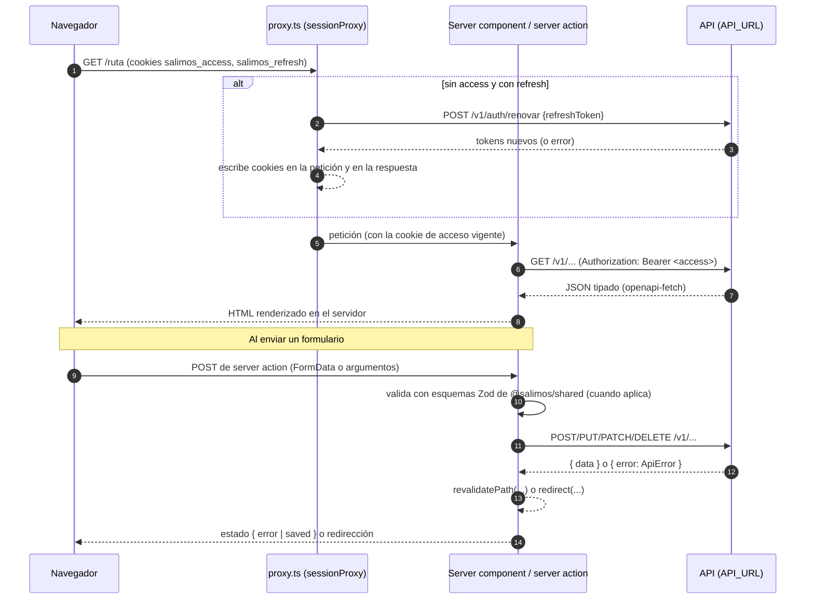
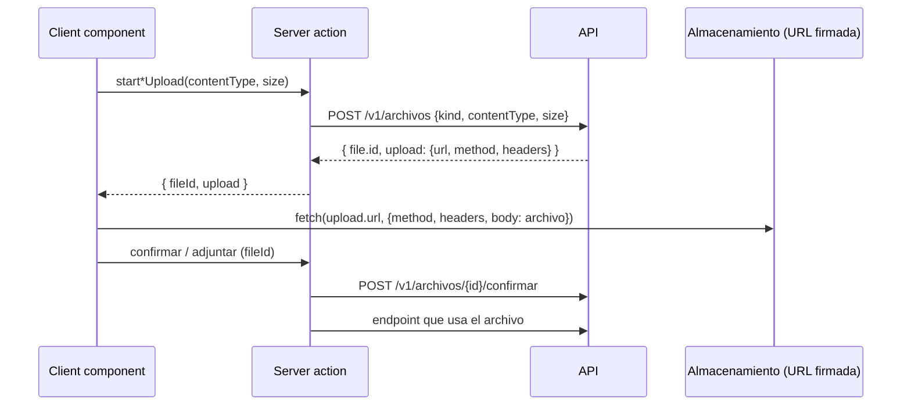
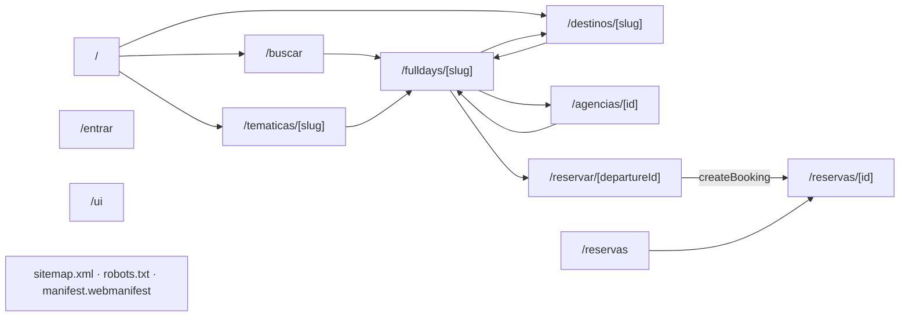
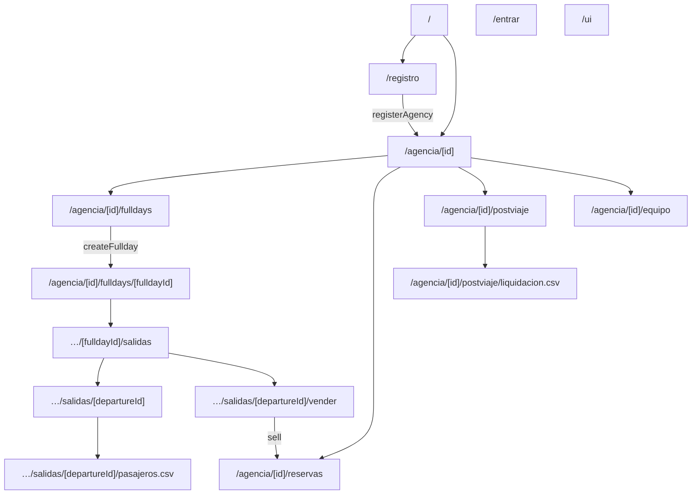
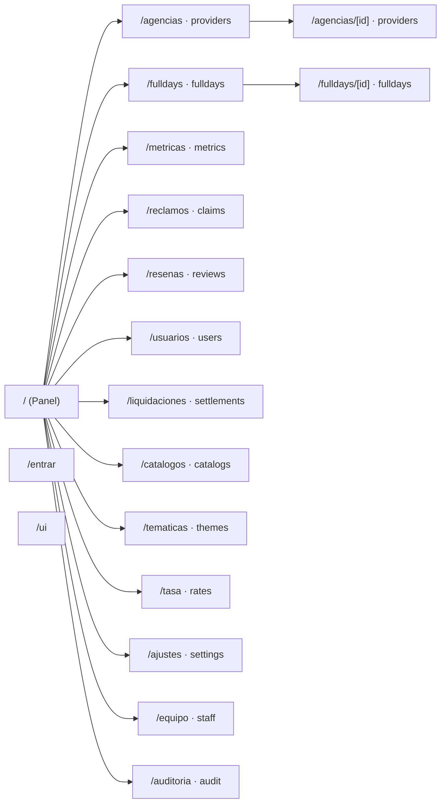
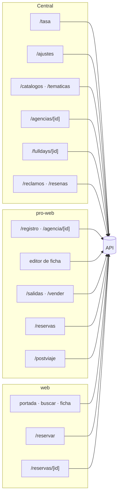

# Aplicaciones web

Documentación técnica de las tres aplicaciones Next.js del monorepo:

| App            | Paquete            | Puerto (dev y start) | Para quién                      |
| -------------- | ------------------ | -------------------- | ------------------------------- |
| `apps/web`     | `@salimos/web`     | 3100                 | Viajeros (sitio público)        |
| `apps/pro-web` | `@salimos/pro-web` | 3101                 | Agencias (dueño y su equipo)    |
| `apps/central` | `@salimos/central` | 3102                 | Equipo interno de la plataforma |

Los puertos salen de los scripts `dev` y `start` de cada `package.json`. Todo lo que sigue se lee del código actual; cuando algo no existe se marca con **Todavía no:**.

Documentos relacionados:

- Flujos de uso (qué hace cada persona, paso a paso): [`../flujos/salimos-web.md`](../flujos/salimos-web.md), [`../flujos/pro-web.md`](../flujos/pro-web.md), [`../flujos/central.md`](../flujos/central.md).
- Arquitectura: [`../arquitectura/api.md`](../arquitectura/api.md), [`../arquitectura/seguridad.md`](../arquitectura/seguridad.md), [`../arquitectura/entornos.md`](../arquitectura/entornos.md), [`../arquitectura/modelo-de-datos.md`](../arquitectura/modelo-de-datos.md).
- Documentación técnica hermana: [`README.md`](README.md), [`api.md`](api.md), [`paquetes.md`](paquetes.md), [`apps-moviles.md`](apps-moviles.md), [`integracion.md`](integracion.md).

---

## 1. Lo común a las tres apps

### 1.1 Cómo están construidas

- **Next.js 16.4.1 con App Router** (`apps/*/package.json`), React 19.3.0, Tailwind 4 vía `@tailwindcss/postcss`. Cada ruta es una carpeta bajo `apps/<app>/app/` con su `page.tsx` o `route.ts`.
- **Server components por defecto.** Todas las `page.tsx` son componentes de servidor `async`: leen la sesión, llaman a la API y renderizan HTML. No hay `"use client"` en ninguna página.
- **Client components solo para interacción.** Los formularios con estado (`useActionState`, temporizadores, subida de archivos, editor de ficha) viven en archivos hermanos marcados `"use client"`: `forms.tsx`, `form.tsx`, `team.tsx`, `company.tsx`, `documents.tsx`, `decision.tsx`, `sale.tsx`, `editor.tsx`, y los componentes de `@salimos/ui-web` (`SignInForm`, `BookingForm`).
- **Server actions** (`"use server"`) en archivos `actions.ts` junto a cada ruta. Son la única forma en que el navegador provoca escrituras: el client component llama a la acción, la acción corre en el servidor Next con el token de la cookie y llama a la API.
- **Sin estado global de cliente, sin `fetch` del navegador a la API.** La única petición que el navegador hace fuera del servidor Next es la subida directa de un archivo a la URL firmada que devuelve `POST /v1/archivos` (ver 1.7).
- **`next.config.ts`** (idéntico en las tres apps):
  - `poweredByHeader: false`: no se envía `X-Powered-By`.
  - Cabeceras en todas las rutas (`source: "/:path*"`): `X-Content-Type-Options: nosniff`, `X-Frame-Options: DENY`, `Referrer-Policy: strict-origin-when-cross-origin`. El comentario explica el motivo: ninguna página se enmarca, el navegador no adivina tipos y las direcciones completas (que llevan ids de reserva) no viajan como referrer.
  - `transpilePackages: ["@salimos/ui-web", "@salimos/web-session", "@salimos/api-client"]`, porque esos paquetes del workspace publican TypeScript sin compilar.
  - **Todavía no:** no hay `Content-Security-Policy` ni `Strict-Transport-Security` en `next.config.ts`.
- **Layouts.** `apps/<app>/app/layout.tsx` fija `lang="es"`, carga las fuentes locales de `packages/tokens/fonts/` y define `metadata.title`. `apps/web/app/layout.tsx` además fija `metadataBase` con `SITE_URL`. `pro-web` y `central` marcan el `<html>` con `data-product="pro"` y `data-product="central"`.
- **Todavía no:** no existe ningún `error.tsx`, `loading.tsx` ni `not-found.tsx` propio en ninguna app. Un error no controlado muestra la página de error por defecto de Next y `notFound()` muestra el 404 por defecto.

### 1.2 Flujo de una petición

### 1.3 Sesión: `@salimos/web-session`

El paquete `packages/web-session` exporta tres entradas (`package.json`): `./session`, `./actions` y `./proxy`.

`packages/web-session/src/session.ts`:

| Export              | Qué hace                                                                                                                                                                                                                                                     |
| ------------------- | ------------------------------------------------------------------------------------------------------------------------------------------------------------------------------------------------------------------------------------------------------------ |
| `ACCESS_COOKIE`     | `salimos_access`.                                                                                                                                                                                                                                            |
| `REFRESH_COOKIE`    | `salimos_refresh`.                                                                                                                                                                                                                                           |
| `api(accessToken?)` | Cliente tipado: `createApiClient(process.env.API_URL ?? "http://localhost:4000", accessToken)`. Sin token solo sirve para endpoints públicos.                                                                                                                |
| `sessionCookies(t)` | Las dos cookies para un par de tokens: `httpOnly`, `sameSite: "lax"`, `secure` solo con `NODE_ENV === "production"`, `path: "/"`. La de acceso dura `expiresIn - 30` segundos; la de renovación 60 días (debe coincidir con `REFRESH_TOKEN_DAYS` de la API). |
| `saveSession(t)`    | Escribe las dos cookies.                                                                                                                                                                                                                                     |
| `clearSession()`    | Borra las dos cookies.                                                                                                                                                                                                                                       |
| `accessToken()`     | Lee la cookie de acceso.                                                                                                                                                                                                                                     |
| `currentUser()`     | `GET /v1/yo` con el token, envuelto en `cache()` de React: una sola llamada por petición aunque la usen varias piezas de la página. Devuelve `null` sin sesión. Trae `memberships` (agencia, rol, permisos) y `staff` (roles y permisos de Central).         |

Como los tokens están en cookies `httpOnly`, el JavaScript del navegador nunca los ve. Solo el código de servidor (componentes, acciones, rutas, proxy) los lee.

`packages/web-session/src/proxy.ts` (`sessionProxy`): corre antes de cada página. Si no hay cookie de acceso pero sí de renovación, llama a `POST /v1/auth/renovar`. Si responde, escribe las cookies nuevas tanto en la petición en curso (para que la página se renderice con sesión) como en la respuesta (para que el navegador las guarde). Si falla (sesión vencida o API caída) borra la cookie de renovación y la página se renderiza sin sesión. Cada app lo monta en su `proxy.ts` raíz (`apps/web/proxy.ts`, `apps/pro-web/proxy.ts`, `apps/central/proxy.ts`) con el mismo `matcher`, que excluye `_next/static`, `_next/image` y archivos `svg|png|jpg|ico|woff2`.

### 1.4 Página de entrada y sus acciones

Las tres apps tienen `app/entrar/page.tsx` con el mismo esqueleto: si `currentUser()` ya devuelve alguien, `redirect("/")`; si no, renderiza `SignInForm` de `@salimos/ui-web` con la acción `signIn` y, solo si existe `process.env.GOOGLE_CLIENT_ID`, el botón de Google con la acción `signInWithGoogle`.

`SignInForm` (`packages/ui-web/src/sign-in-form.tsx`, client component) es un formulario de varios pasos (`SignInState.step`: `enter`, `create`, `verify`, `recover`, `reset`). Cada botón envía un campo `intent` que dice qué paso ejecutar. El botón de Google carga `https://accounts.google.com/gsi/client` en el navegador y entrega el `credential` (id token) a la acción.

`packages/web-session/src/actions.ts`:

| Acción                      | `intent` / entrada | Validación (`@salimos/shared`)                   | Endpoint                          | Resultado                                                                                   |
| --------------------------- | ------------------ | ------------------------------------------------ | --------------------------------- | ------------------------------------------------------------------------------------------- |
| `signIn`                    | `to-<paso>`        | —                                                | —                                 | Cambia de paso conservando el correo escrito.                                               |
| `signIn`                    | `enter`            | `EmailSchema`                                    | `POST /v1/auth/entrar`            | Guarda sesión y `redirect("/")`. Con `error.code === "email_not_verified"` pasa a `verify`. |
| `signIn`                    | `create`           | `EmailSchema`, `PasswordSchema`                  | `POST /v1/auth/registrar`         | Pasa a `verify`.                                                                            |
| `signIn`                    | `recover`          | `EmailSchema`                                    | `POST /v1/auth/recuperar`         | Pasa a `reset`.                                                                             |
| `signIn`                    | `verify`           | `EmailSchema`, `OtpCodeSchema`                   | `POST /v1/auth/verificar`         | Guarda sesión y `redirect("/")`.                                                            |
| `signIn`                    | `reset`            | `EmailSchema`, `OtpCodeSchema`, `PasswordSchema` | `POST /v1/auth/restablecer`       | Guarda sesión y `redirect("/")`.                                                            |
| `signInWithGoogle(idToken)` | —                  | —                                                | `POST /v1/auth/google`            | Guarda sesión y `redirect("/")`, o `{ error }`.                                             |
| `signOut()`                 | —                  | —                                                | `POST /v1/auth/salir` (con token) | Borra cookies aunque la API no responda (`.catch`) y `redirect("/")`.                       |

Errores: si un paso falla, la acción devuelve el mismo paso con `error` (el primer mensaje del esquema Zod o el `message` de la API) y `field` (qué campo marcar). El mensaje genérico es `Algo salió mal. Inténtalo de nuevo.`

**Todavía no:**

- Después de entrar siempre se va a `/` (`packages/web-session/src/actions.ts:42`, `:69`, `:77`): no hay "volver a donde estaba". Un viajero que entra desde `/reservar/<id>` vuelve a la portada.
- El error que devuelve `signInWithGoogle` no se muestra: el callback hace `void action(credential)` (`packages/ui-web/src/sign-in-form.tsx:36`) y descarta el resultado.

`signOut` se usa desde un `<form action={signOut}>` en la portada de `web` (con sesión), en la portada de `pro-web` y en el encabezado del `Panel` de `central`.

### 1.5 Cliente de la API: `@salimos/api-client`

`packages/api-client/src/index.ts` envuelve `openapi-fetch` con los tipos generados de `openapi.json` (`schema.d.ts`). `createApiClient(baseUrl, accessToken?)` agrega `Authorization: Bearer <token>` cuando hay token. Cada llamada devuelve `{ data, error }`; `error` sigue el tipo `ApiError` (con `code`, `message` e `issues` de validación). El código de las apps ramifica por `data`/`error`, nunca por excepciones, y solo mira `error.code` en un caso (`email_not_verified`). Más detalle en [`paquetes.md`](paquetes.md) y en [`api.md`](api.md).

Las apps no importan `@salimos/api-client` directamente: lo usan a través de `api()` de `@salimos/web-session/session`, salvo las dos rutas CSV (ver 1.8).

### 1.6 Variables de entorno que leen las apps

| Variable           | Dónde se lee                                                                                                               | Para qué                                                      | Valor por defecto       |
| ------------------ | -------------------------------------------------------------------------------------------------------------------------- | ------------------------------------------------------------- | ----------------------- |
| `API_URL`          | `packages/web-session/src/session.ts`; las dos rutas CSV de `pro-web`                                                      | Base de todas las llamadas a la API (solo desde el servidor). | `http://localhost:4000` |
| `GOOGLE_CLIENT_ID` | `apps/*/app/entrar/page.tsx`                                                                                               | Mostrar el botón de Google y pasarle el client id.            | sin valor: no hay botón |
| `SITE_URL`         | `apps/web/app/layout.tsx` (`metadataBase`), `apps/web/app/catalog.tsx` (`SITE_URL`, usado por canonical, sitemap y robots) | Direcciones absolutas del sitio público.                      | `http://localhost:3100` |
| `NODE_ENV`         | `packages/web-session/src/session.ts`                                                                                      | Cookies `secure` en producción.                               | lo fija Next            |

Ninguna variable se expone al navegador (no hay `NEXT_PUBLIC_*`). El client id de Google llega al navegador como prop del formulario.

**Todavía no:** [`../arquitectura/entornos.md`](../arquitectura/entornos.md) no menciona `API_URL`, `SITE_URL` ni `GOOGLE_CLIENT_ID`.

### 1.7 Subida de archivos (comprobantes, documentos, fotos)

Las tres subidas siguen el mismo patrón de cuatro pasos, con dos server actions y una petición directa del navegador:

| Uso                        | Acciones                                                                                 | `kind`     | Endpoint final                         |
| -------------------------- | ---------------------------------------------------------------------------------------- | ---------- | -------------------------------------- |
| Comprobante de pago (web)  | `startProofUpload`, `reportPayment` (`apps/web/app/reservas/actions.ts`)                 | `document` | `POST /v1/reservas/{id}/pagos`         |
| Documento de agencia (pro) | `startDocumentUpload`, `attachDocument` (`apps/pro-web/app/agencia/[id]/actions.ts`)     | `document` | `POST /v1/pro/{providerId}/documentos` |
| Foto de fullday (pro)      | `startPhotoUpload`, `confirmPhoto` (`apps/pro-web/app/agencia/[id]/fulldays/actions.ts`) | `image`    | la ficha se guarda con `saveFullday`   |

El tipo y el tamaño los valida la API; el `contentType` se castea solo para el compilador. Si la subida directa falla, el formulario muestra `No se pudo subir el comprobante. Revisa tu conexión.` o `No se pudo subir la foto. Revisa tu conexión.`

### 1.8 Rutas CSV (`*.csv/route.ts`)

`pro-web` tiene dos route handlers `GET` que hacen de pasarela hacia archivos CSV de la API. Existen porque el token vive solo en cookies del servidor: un enlace directo del navegador a la API no llevaría `Authorization`.

| Ruta                                                                     | Llama a                                                         | Nombre de descarga                  |
| ------------------------------------------------------------------------ | --------------------------------------------------------------- | ----------------------------------- |
| `/agencia/[id]/fulldays/[fulldayId]/salidas/[departureId]/pasajeros.csv` | `GET {API_URL}/v1/pro/{id}/salidas/{departureId}/pasajeros.csv` | `pasajeros-<8 primeros del id>.csv` |
| `/agencia/[id]/postviaje/liquidacion.csv?mes=`                           | `GET {API_URL}/v1/pro/{id}/liquidaciones.csv?mes=`              | `liquidacion-<mes>.csv`             |

Ambas usan `fetch` nativo con `Authorization: Bearer <cookie>`, devuelven el cuerpo en streaming con `Content-Type: text/csv; charset=utf-8` y `Content-Disposition: attachment`. Si la API no responde `ok`, devuelven `No se pudo generar el archivo.` con el mismo código de estado. El permiso lo comprueba la API.

### 1.9 Quién ve qué

La API es la que hace cumplir los permisos. Las apps solo ocultan lo que la persona no puede usar. El modelo está en `packages/shared/src/access.ts`:

| Rol de agencia (`PROVIDER_ROLES`) | Permisos                                                                                                                   |
| --------------------------------- | -------------------------------------------------------------------------------------------------------------------------- |
| `owner`                           | todos: `team`, `company`, `fulldays`, `departures`, `bookings`, `notices`, `payments`, `settlements`, `reports`, `checkin` |
| `operations`                      | `fulldays`, `departures`, `bookings`, `notices`                                                                            |
| `finance`                         | `payments`, `settlements`, `reports`                                                                                       |
| `guide`                           | `checkin`, `notices`                                                                                                       |

| Rol de Central (`STAFF_ROLES`, se suman) | Permisos                                                                         |
| ---------------------------------------- | -------------------------------------------------------------------------------- |
| `super`                                  | todos (`STAFF_PERMISSIONS`), incluidos `staff`, `audit`, `providers`, `settings` |
| `support`                                | `users`, `bookings`, `claims`                                                    |
| `moderation`                             | `reviews`, `content`, `fulldays`                                                 |
| `content`                                | `catalogs`, `themes`                                                             |
| `finance`                                | `commissions`, `payments`, `refunds`, `settlements`, `rates`, `metrics`          |

Cómo lo aplica cada app:

- **`web`:** las páginas públicas no piden sesión. `/reservas`, `/reservas/[id]` redirigen a `/entrar` sin sesión; `/reservar/[departureId]` muestra un aviso para entrar en lugar del formulario.
- **`pro-web`:** cada página bajo `/agencia/[id]` redirige a `/entrar` sin sesión. Para el resto se apoya en la API: si la llamada principal no trae datos (no es del equipo o no tiene el permiso), llama a `notFound()`. `/reservas` y `/postviaje` además leen `user.memberships[].permissions` para decidir qué secciones cargar y mostrar.
- **`central`:** todas las páginas se envuelven en `Panel` (`apps/central/app/panel.tsx`) con un `permission` opcional. `Panel` redirige a `/entrar` sin sesión, muestra `Esta cuenta no tiene acceso` si la cuenta no es del equipo (`user.staff` vacío) o no tiene el permiso, y solo lista en la navegación las secciones permitidas. El contenido que carga datos es un componente hijo `async` que solo se renderiza (y por tanto solo llama a la API) cuando el acceso está permitido.

### 1.10 Manejo de errores

Patrones repetidos en las tres apps:

- **Lecturas:** `const { data = [] } = await api(...).GET(...)`. Si la API falla, la página se renderiza con la lista vacía y su `EmptyState`. Para un recurso único se usa `if (!data) notFound()` (`web`, `pro-web`) o un `EmptyState` (`No encontramos esa agencia`, `No encontramos ese fullday` en `central`).
- **Escrituras:** las acciones devuelven un estado `{ error?: string; saved?: string | boolean }`. El mensaje es `error.issues?.[0]?.message ?? error.message` (primer problema de validación de la API o su mensaje), y el client component lo muestra en `Alert tone="error"`. El éxito se muestra con `Alert tone="success"` o refrescando la página con `revalidatePath`.
- **Validación previa con Zod compartido** donde la app construye el cuerpo: `BookingSelectionSchema`, `ReportPaymentSchema`, `ProviderInputSchema`, `ScheduleDeparturesSchema`, `FulldaySheetSchema`, `SearchQuerySchema`, `EmailSchema`, `PhoneSchema`, `PasswordSchema`, `OtpCodeSchema`. En el resto, la app manda el cuerpo tal cual y la API valida.
- **Mensaje genérico:** `Algo salió mal. Inténtalo de nuevo.` cuando la API no da mensaje.
- **Todavía no:** cuando la API está caída no hay distinción entre "vacío" y "no se pudo leer" en la mayoría de las listas; por ejemplo, la portada de `web` muestra `Pronto verás aquí las salidas`. Las excepciones son `central` en `/metricas` (`No pudimos leer las métricas`) y `/ajustes` (`No pudimos leer los ajustes.`).

### 1.11 UI compartida: `@salimos/ui-web`

`packages/ui-web/src/index.ts` exporta: `BookingForm`, `Button`, `buttonClasses`, `Chip`, `Dialog`, `Checkbox`, `Field`, `Select`, `TextArea`, `FulldayPreview`, `Alert`, `Card`, `EmptyState`, `Glass`, `Table`, `QrCode`, `SignInForm`, `SignInState`. Aparte, `@salimos/ui-web/showcase` exporta `Showcase`, que cada app monta en `/ui`.

Los dos componentes con lógica de dominio:

- **`BookingForm`** (client): selección de pasajeros, comidas, habitaciones y punto de embarque, con el precio recalculado en vivo usando `quote` y `checkSelection` de `@salimos/shared`; el comentario dice que el mismo `quote` corre en la API. Recibe un `onSubmit(selection)` que en `web` es `createBooking` y en `pro-web` es `sell`.
- **`FulldayPreview`**: renderiza una `FulldaySheet` completa. Lo usan la ficha pública (`web`), el editor (`pro-web`) y la moderación (`central`).

Detalle de cada componente en [`paquetes.md`](paquetes.md).

### 1.12 Página `/ui` (las tres apps)

`apps/web/app/ui/page.tsx`, `apps/pro-web/app/ui/page.tsx`, `apps/central/app/ui/page.tsx`: renderizan `<Showcase product="…" />` con los componentes de `@salimos/ui-web`. Sin datos, sin sesión, estática. En `web` tiene `robots: { index: false }` y está en el `disallow` de `robots.ts`. **Todavía no:** no está restringida: cualquiera puede abrirla en las tres apps.

---

## 2. `apps/web` (viajeros)

### 2.1 Mapa de rutas

### 2.2 Módulo compartido `app/catalog.tsx`

No es una ruta; lo importan todas las páginas públicas:

- `searchDepartures(query)`: `GET /v1/salidas` con los filtros como texto en la query, tal como los lee la API. Devuelve `null` si falla.
- `todayRate()`: `GET /v1/tasa` → `bsPerUsd` o `null` si Central no cargó tasa.
- `departureCities()`: `GET /v1/catalogos/puntos-de-embarque` → ciudades únicas ordenadas con `localeCompare(…, "es")`.
- `fulldayHref(id, title)` → `/fulldays/<slug del título>-<uuid>`; `fulldayIdOf(slug)` toma los últimos 36 caracteres. El título es decorativo: cuenta el id.
- `Price` (USD y referencia en bolívares con `bolivares()` de `@salimos/shared`), `seatsText` (`Sin cupos`, `Queda 1 puesto`, `Quedan N puestos`), `DepartureCard`, `DepartureList`, `SiteHeader` (enlaces a `/buscar`, `/reservas`, `/entrar`), `formatDay` (`es-VE`, zona UTC).
- `SearchForm`: un `<form action="/buscar">` normal (GET), sin JavaScript, cuya dirección se puede compartir. Campos: `q`, `desde`, `fechaDesde`, `fechaHasta`; en la versión completa además `categoria` (`FULLDAY_CATEGORIES`), `duracion` (`DURATION_TYPES`), `precioMax`, `orden` (`SEARCH_ORDERS`, por defecto `recomendados`), `incluye` (casillas de `INCLUDES`), `verificados`, `ninos`, `mascotas`.

Las fotos llegan ya redimensionadas (`photo.md`, `photo.lg`) y se pintan con ``, no con `next/image` (comentario: `already resized by imgproxy`).

### 2.3 `/` — `app/page.tsx`

- **Renderiza:** con sesión, un saludo (`Hola, <nombre>.`); sin sesión, la cabecera de bienvenida con enlace a `/entrar`. Luego el buscador compacto, enlaces por categoría (`/buscar?categoria=<categoria>`), enlaces a temáticas, las 6 primeras salidas (`HOME_DEPARTURES`), la lista de destinos y, con sesión, el botón `Salir`.
- **Datos (en paralelo):** `currentUser()` (`GET /v1/yo`), `searchDepartures()` (`GET /v1/salidas`), `todayRate()` (`GET /v1/tasa`), `departureCities()` (`GET /v1/catalogos/puntos-de-embarque`), `GET /v1/catalogos/destinos`, `GET /v1/tematicas`.
- **Acciones:** `signOut`.
- **Estados:** sin salidas, `EmptyState` `Pronto verás aquí las salidas`. Temáticas y destinos solo aparecen si hay alguno.
- **Acceso:** público.

### 2.4 `/buscar` — `app/buscar/page.tsx`

- **Renderiza:** el `SearchForm` completo, el total (`1 salida` / `N salidas`), la lista de tarjetas y paginación `Anteriores` / `Página X de Y` / `Siguientes`.
- **Datos:** `flatten(searchParams)` une los valores repetidos (casillas) con comas. Se valida con `SearchQuerySchema`; si la dirección no es válida (editada a mano), busca sin filtros en vez de fallar. Luego `searchDepartures(filtros)`, `todayRate()`, `departureCities()`. Las páginas se calculan con `total / pageSize` de la respuesta.
- **Acciones:** ninguna (formulario GET).
- **Estados:** `No hay salidas con esos filtros`.
- **Acceso:** público. `metadata` con título y descripción fijos.

### 2.5 `/fulldays/[slug]` — `app/fulldays/[slug]/page.tsx`

- **Renderiza:** título, destino (enlace a `/destinos/<slug>`), duración, categoría, edad mínima, agencia (enlace a `/agencias/<id>`, con `Agencia verificada` o `Agencia nueva`), precio "desde" (mínimo de las salidas), galería, próximas salidas con cupos, precio y enlace `/reservar/<departureId>` cuando la salida está `open` y tiene cupos, la ficha completa con `FulldayPreview` y las reseñas.
- **Datos:** `load(slug)` con `cache()` de React, compartido por `generateMetadata` y la página: `GET /v1/fulldays/{id}` (id sacado del slug). Luego `todayRate()` y `GET /v1/fulldays/{id}/resenas`.
- **SEO:** `generateMetadata` arma título `<título> · <agencia> · Salimos`, descripción corta, `alternates.canonical` con `SITE_URL` + `fulldayHref` (así un slug con otro título apunta a la dirección correcta) y `openGraph` con la primera foto. Incluye JSON-LD `schema.org/Product` con `AggregateOffer` (USD, precio mínimo y máximo, número de salidas, `InStock` o `SoldOut`); el JSON se escapa (`<` → `<`) antes de `dangerouslySetInnerHTML`.
- **Estados:** sin el fullday, `notFound()`. Reseñas solo si `reviews.reviews > 0`, con nota, porcentaje de "se cumplió la ficha" (`fulfilledPercent`) y la respuesta de la agencia.
- **Acceso:** público.

### 2.6 `/destinos/[slug]` — `app/destinos/[slug]/page.tsx`

- **Renderiza:** el destino o el lugar dentro de un destino, su estado, enlace al destino padre, lista de lugares hijos, `Costos que se pagan allá` (tasas con forma de pago) y próximas salidas.
- **Datos:** `load(slug)` recorre `GET /v1/catalogos/destinos` (destinos con `children`) buscando el slug. Luego `searchDepartures({ destino: slug })` y `todayRate()`.
- **Estados:** `notFound()` si el slug no existe; `Aún no hay salidas a este destino`.
- **Acceso:** público. `generateMetadata` con título `Fulldays a <nombre> · Salimos`.

### 2.7 `/tematicas/[slug]` — `app/tematicas/[slug]/page.tsx`

- **Renderiza:** nombre y descripción de la temática, y sus salidas.
- **Datos:** `GET /v1/tematicas` filtrado por slug; luego `searchDepartures({ tematica: slug })` y `todayRate()`.
- **Estados:** `notFound()`; `Aún no hay salidas en esta temática`.
- **Acceso:** público.

### 2.8 `/agencias/[id]` — `app/agencias/[id]/page.tsx`

- **Renderiza:** nombre, insignia (`Agencia verificada` / `Agencia nueva`), ciudad base, Instagram, y cada fullday publicado con foto, descripción corta, próxima fecha (`Sin fechas por ahora`) y precio por adulto.
- **Datos:** `GET /v1/agencias/{id}` (con `cache()` para metadata y página) y `todayRate()`.
- **Estados:** `notFound()`; `Esta agencia aún no tiene fulldays publicados`.
- **Acceso:** público.

### 2.9 `/entrar` — `app/entrar/page.tsx`

Ver 1.4. Con sesión redirige a `/`. Está en el `disallow` de `robots.ts`.

### 2.10 `/reservar/[departureId]` — `app/reservar/[departureId]/page.tsx`

- **Renderiza:** enlace a la ficha, `Reservar para el <día>`, agencia y, según el estado:
  - salida sin cupos o no `open`: `Alert` `Esta salida ya no tiene cupos`;
  - sin sesión: `Alert` `Entra para reservar` y botón a `/entrar`;
  - con sesión: `BookingForm` con fecha, ficha, precio de adulto, cupos, opciones de comida (`mealOptions`), tipos de habitación (`roomTypes`) y tasa.
- **Datos:** `GET /v1/salidas/{id}`, `todayRate()`, `currentUser()`.
- **Acción:** `createBooking(departureId, selection)` (`app/reservar/actions.ts`): valida con `BookingSelectionSchema` (`Revisa los pasajeros y lo que escogiste.`), llama a `POST /v1/reservas` con `{ departureId, selection }` y redirige a `/reservas/<id>`. Si la API rechaza, devuelve el primer `issue` o el mensaje.
- **Acceso:** lectura pública; reservar requiere sesión. `robots: { index: false }`.
- **Todavía no:** el aviso dice `Con tu teléfono y un código` (`app/reservar/[departureId]/page.tsx:39`), pero la entrada es con correo y contraseña o Google (ver 1.4).

### 2.11 `/reservas` — `app/reservas/page.tsx`

- **Renderiza:** las reservas del viajero con título del fullday (enlace a `/reservas/<id>`), fecha, puestos, código, estado (`BOOKING_STATUS_LABELS`) y `pagado $X de $Y`.
- **Datos:** `GET /v1/reservas` con token.
- **Estados:** sin sesión, `redirect("/entrar")`; `Aún no tienes reservas`.
- **Acceso:** viajero con sesión. `robots: { index: false }`.

### 2.12 `/reservas/[id]` — `app/reservas/[id]/page.tsx`

La página más completa de `web`. Todo con el token del viajero.

**Datos**, en tres tandas:

1. `GET /v1/reservas/{id}`, `GET /v1/reservas/{id}/pagos`, `GET /v1/ajustes` (métodos de pago permitidos), `todayRate()`.
2. `GET /v1/salidas/{id}` de la salida de la reserva (para la ficha y las comidas).
3. `GET /v1/reservas/{id}/vouchers` (solo si el estado es `deposit_paid` o `paid`), `GET /v1/reservas/{id}/avisos`, `GET /v1/reservas/{id}/cancelacion` (vista previa del reembolso) y `GET /v1/reclamos` filtrado por `bookingId`.

**Cálculos en el servidor:** `alive` (no está en `expired`, `cancelled`, `completed`, `no_show`); `waiting` (suma de pagos `pending`); `owed = balanceUsd - waiting`; `toConfirm = depositUsd - paidUsd - waiting` (lo que falta para confirmar). Se redondea a centavos.

**Secciones y estados:**

| Sección                        | Cuándo aparece                | Contenido                                                                                                                                                                                            |
| ------------------------------ | ----------------------------- | ---------------------------------------------------------------------------------------------------------------------------------------------------------------------------------------------------- |
| `Falta tu pago para confirmar` | estado `held` con `heldUntil` | `HoldTimer` (client): cuenta regresiva `Tus puestos están apartados por M:SS min.`; renderiza solo tras montar para no discrepar con el servidor; al llegar a cero, `El tiempo para pagar se agotó.` |
| Aviso en revisión              | `in_review`                   | `La agencia está revisando tu pago`.                                                                                                                                                                 |
| Aviso vencido                  | `expired`                     | `El apartado venció`.                                                                                                                                                                                |
| Avisos de la agencia           | hay avisos                    | Texto y fecha en `America/Caracas`.                                                                                                                                                                  |
| Embarque                       | punto encontrado y `alive`    | Nombre, hora de salida y regreso, enlace `Cómo llegar` a Google Maps con el nombre del punto.                                                                                                        |
| `¡Listo, salimos!`             | hay vouchers                  | Un `QrCode` por pasajero con `voucher.token`.                                                                                                                                                        |
| Precio                         | siempre                       | `priceLines`, total, pagado, falta y fecha límite del saldo.                                                                                                                                         |
| Pagar                          | `alive` y `owed > 0`          | Datos de pago de la agencia (`provider.paymentInstructions`) o `La agencia aún no cargó sus datos de pago.`; referencia en bolívares; `PaymentForm`.                                                 |
| Pagos reportados               | hay pagos                     | Monto, método, estado, referencia y monto en Bs con su tasa.                                                                                                                                         |
| Pasajeros                      | `alive` y hay salida          | `PassengersForm`.                                                                                                                                                                                    |
| Reembolso                      | `booking.refund`              | `Reembolso enviado` o `Reembolso pendiente`, monto y regla.                                                                                                                                          |
| `¿Cómo estuvo el viaje?`       | `completed`                   | `ReviewForm` o `Ya reseñaste este viaje. ¡Gracias!`.                                                                                                                                                 |
| Reclamos                       | `paidUsd > 0`                 | Un `ClaimThread` por reclamo y `ClaimForm` dentro de `Tengo un problema con esta reserva`.                                                                                                           |
| Cancelar                       | `alive`                       | `CancelButton` con la vista previa del reembolso.                                                                                                                                                    |

**Acciones** (`app/reservas/actions.ts`; todas llaman a `revalidatePath("/reservas/<id>")`):

| Acción / formulario                                  | Endpoint(s)                                                                                             | Validación            | Mensajes                                  |
| ---------------------------------------------------- | ------------------------------------------------------------------------------------------------------- | --------------------- | ----------------------------------------- |
| `startProofUpload` + `reportPayment` (`PaymentForm`) | `POST /v1/archivos`, subida directa, `POST /v1/archivos/{id}/confirmar`, `POST /v1/reservas/{id}/pagos` | `ReportPaymentSchema` | `Pago reportado. La agencia lo revisará.` |
| `savePassengers` (`PassengersForm`)                  | `PUT /v1/reservas/{id}/pasajeros`                                                                       | API                   | `Pasajeros guardados.`                    |
| `cancelBooking` (`CancelButton`)                     | `POST /v1/reservas/{id}/cancelar`                                                                       | API                   | error de la API                           |
| `sendReview` (`ReviewForm`)                          | `POST /v1/reservas/{id}/resena`                                                                         | API                   | `Gracias por tu reseña.`                  |
| `claim` con `{ open: true }` (`ClaimForm`)           | `POST /v1/reservas/{id}/reclamos`                                                                       | API                   | `Reclamo enviado a la agencia.`           |
| `claim` con `{ reply }` (`ClaimThread`)              | `POST /v1/reclamos/{id}/mensajes`                                                                       | API                   | `Enviado.`                                |
| `claim` con `{ escalate }` (`ClaimThread`)           | `POST /v1/reclamos/{id}/escalar`                                                                        | API                   | `Enviado.`                                |

Detalles:

- `PaymentForm` campos: `method` (de `settings.paymentMethods`), `amountUsd` (mínimo 0.01, máximo `owed`, sugerido `toConfirm || owed`), `reference`, `proof` opcional (`application/pdf,image/jpeg,image/png`). Genera una `idempotencyKey` con `crypto.randomUUID()` por intento y la renueva solo cuando el pago se guarda: enviar dos veces el mismo intento no crea dos pagos.
- `savePassengers` lee `count` y, para cada posición, `name-<n>`, `cedula-<n>` y las comidas `meal-<n>-<momento>`.
- `sendReview` envía `rating`, los aspectos `punctuality`, `transport`, `food`, `guide`, `value`, `fulfilled` y `comment`.
- `ClaimThread` muestra `Decisión de Salimos` cuando Central resolvió.

**Acceso:** viajero con sesión; sin sesión `redirect("/entrar")`; si la API no devuelve la reserva (no es suya), `notFound()`. `robots: { index: false }`.

**Todavía no:**

- `reportPayment` confirma el archivo (`POST /v1/archivos/{id}/confirmar`, `app/reservas/actions.ts:30`) antes de validar el cuerpo con `ReportPaymentSchema` (`:33`): un formulario inválido deja un archivo confirmado sin pago.
- `CancelButton` cancela con un solo clic; no hay paso de confirmación (solo el texto con el reembolso previsto).

### 2.13 SEO, caché y archivos de metadatos

- **Renderizado dinámico.** Ninguna página exporta `revalidate`, `dynamic` (salvo el sitemap) ni usa `"use cache"`, y `cacheComponents` no está activo en `next.config.ts`. Las páginas leen `searchParams`, `params` sin `generateStaticParams` o cookies, así que se renderizan en cada petición con datos frescos de la API. En el último build local (`apps/web/.next/prerender-manifest.json`, no versionado) solo quedaron prerenderizados `/ui`, `/robots.txt`, `/manifest.webmanifest` y los íconos.
- **`revalidatePath`** se usa en las acciones para refrescar la página tras una escritura; como las páginas son dinámicas, su efecto práctico es volver a renderizar la ruta actual en la respuesta de la acción.
- **`sitemap.ts`:** `dynamic = "force-dynamic"` (un fullday publicado hace un minuto ya debe estar). Recorre `GET /v1/salidas?pagina=N` hasta 25 páginas (`MAX_PAGES`) juntando fulldays y agencias, y agrega destinos y sus lugares de `GET /v1/catalogos/destinos`. Emite `/`, `/buscar`, cada `fulldayHref`, cada `/destinos/<slug>` y cada `/agencias/<id>`, con `SITE_URL` delante. Un comentario `ponytail:` marca el límite: con miles de salidas hará falta un endpoint que liste direcciones públicas.
- **`robots.ts`:** permite todo salvo `/ui` y `/entrar`, y apunta a `${SITE_URL}/sitemap.xml`.
- **`manifest.ts`:** manifiesto de app instalable (`display: "standalone"`, `start_url: "/"`, íconos `/icon.svg` y `/apple-icon.png`).
- **`noindex`:** `/reservar/[departureId]`, `/reservas`, `/reservas/[id]` y `/ui` declaran `robots: { index: false }`.
- **Metadatos por página:** `generateMetadata` en `/fulldays/[slug]`, `/destinos/[slug]`, `/tematicas/[slug]` y `/agencias/[id]`, reutilizando el mismo `load` con `cache()` para no pedir dos veces a la API.

**Todavía no:**

- El sitemap no incluye `/tematicas/<slug>` (`app/sitemap.ts`).
- `robots.txt` y `manifest.webmanifest` se prerenderizan en el build: el `SITE_URL` que lleva `robots.txt` es el del momento del build, no el del arranque.
- No hay `canonical` en destinos, temáticas ni agencias; solo en la ficha del fullday.

---

## 3. `apps/pro-web` (agencias)

### 3.1 Mapa de rutas

Ninguna página de `pro-web` define `robots`; tampoco existe `robots.ts` en esta app.

### 3.2 `/` — `app/page.tsx`

- **Renderiza:** sin sesión, la bienvenida con enlace a `/entrar`. Con sesión, `Hola, <nombre>.`, una tarjeta por membresía (`user.memberships`) con el nombre de la agencia y el rol (`PROVIDER_ROLE_LABELS`), el botón `Registrar mi agencia` (`/registro`) y `Salir`.
- **Datos:** `currentUser()` (`GET /v1/yo`).
- **Destino de cada rol** (`HOME`): `owner` → `/agencia/<id>`; `operations` → `/agencia/<id>/fulldays`; `finance` → `/agencia/<id>/reservas`; `guide` → `/agencia/<id>`.
- **Estados:** sin membresías, `Aún no perteneces a ninguna agencia`.
- **Acceso:** público; el contenido cambia con la sesión.
- **Todavía no (bug):** el rol `guide` va a `/agencia/<id>` (`app/page.tsx:14`), que carga `GET /v1/pro/{providerId}/empresa`, protegido con `@Can('company')` en la API (`apps/api/src/providers/providers.controller.ts:100-101`). `company` es solo del dueño, así que el guía recibe un 404. Además los enlaces `Mi agencia` de las demás páginas llevan a `operations` y `finance` al mismo 404. No hay una pantalla de check-in para el guía en `pro-web`.

### 3.3 `/entrar` — `app/entrar/page.tsx`

Ver 1.4.

### 3.4 `/registro` — `app/registro/page.tsx`

- **Renderiza:** `RegistrationForm` (`app/registro/form.tsx`) con `kind` (tipo), `name`, `legalName`, `rif` (ejemplo `J-12345678-9`), `rtn` opcional, `baseCity`, `phone`, `instagram` opcional.
- **Acción:** `registerAgency` (`app/registro/actions.ts`): valida con `ProviderInputSchema`; los errores se devuelven por campo (`errors[campo]`) y se muestran bajo cada `Field`. Llama a `POST /v1/proveedores` y redirige a `/agencia/<id>`.
- **Acceso:** con sesión; sin sesión `redirect("/entrar")`. Cualquier cuenta puede registrar una agencia y queda como dueña.

### 3.5 `/agencia/[id]` — `app/agencia/[id]/page.tsx`

- **Renderiza:** nombre, enlace `Mis agencias`, motivo de rechazo/suspensión (`statusReason`), aviso `Tu agencia está en revisión` cuando `status === "in_review"`, datos de la empresa con el formulario de edición plegado, documentos por tipo (`PROVIDER_DOCUMENT_TYPES`) con `Ver <documento>` (`downloadUrl`), quitar y subir, enlaces a `Fulldays`, `Reservas y pagos`, `Después del viaje`, `Equipo`, y `SendToReview` cuando el estado es `pending` o `rejected`.
- **Datos:** `GET /v1/pro/{providerId}/empresa` y `GET /v1/pro/{providerId}/documentos`.
- **Acciones** (`app/agencia/[id]/actions.ts`, todas con `revalidatePath("/agencia/<id>")`):

| Acción                                                      | Endpoint(s)                                                                                                     | Validación                                                                                                                                                                     |
| ----------------------------------------------------------- | --------------------------------------------------------------------------------------------------------------- | ------------------------------------------------------------------------------------------------------------------------------------------------------------------------------ |
| `updateCompany` (`CompanyForm`)                             | `PATCH /v1/pro/{providerId}/empresa`                                                                            | `ProviderInputSchema.omit({ rif: true })`: el RIF no cambia; errores por campo; incluye `paymentInstructions` (los datos de pago que ve el viajero). Éxito: `Datos guardados.` |
| `startDocumentUpload` + `attachDocument` (`DocumentUpload`) | `POST /v1/archivos`, subida directa, `POST /v1/archivos/{id}/confirmar`, `POST /v1/pro/{providerId}/documentos` | API                                                                                                                                                                            |
| `removeDocument` (`RemoveDocument`)                         | `DELETE /v1/pro/{providerId}/documentos/{documentId}`                                                           | API                                                                                                                                                                            |
| `sendToReview` (`SendToReview`)                             | `POST /v1/pro/{providerId}/empresa/enviar`                                                                      | API                                                                                                                                                                            |

- **Estados:** en revisión (`locked`) no se puede editar ni tocar documentos.
- **Acceso:** permiso `company` (dueño). Sin datos, `notFound()`.

### 3.6 `/agencia/[id]/fulldays` — `app/agencia/[id]/fulldays/page.tsx`

- **Renderiza:** tabla con título (`Sin título` si falta), estado (`FULLDAY_STATUS_LABELS`) y porcentaje de ficha completa; botón `Nuevo fullday`.
- **Datos:** `GET /v1/pro/{providerId}/fulldays`.
- **Acción:** `createFullday(providerId)`: `POST /v1/pro/{providerId}/fulldays` con cuerpo vacío y redirige al editor.
- **Estados:** `Aún no tienes fulldays`.
- **Acceso:** permiso `fulldays` (dueño, operaciones). Sin datos, `notFound()`.
- **Todavía no:** si la API rechaza la creación, `createFullday` no devuelve ni muestra nada (`app/agencia/[id]/fulldays/actions.ts:15`).

### 3.7 `/agencia/[id]/fulldays/[fulldayId]` — editor de ficha

`page.tsx` carga en paralelo `GET /v1/pro/{providerId}/fulldays/{fulldayId}`, `GET /v1/catalogos/destinos`, `GET /v1/catalogos/puntos-de-embarque` y `GET /v1/catalogos/platos`, arma los catálogos (los lugares se listan como `Destino · Lugar`, los puntos como `Nombre (Ciudad)`) y renderiza `SheetEditor` (`editor.tsx`, client). Enlaces a `Fulldays` y `Salidas`.

**Pasos** (`STEPS` en `editor.tsx`): `Datos generales`, `Fotos`, `Itinerario`, `Traslado`, `Comidas`, `Hidratación, toldos y accesos`, `Alojamiento` (solo si `general.nights > 0`), `Qué llevar`, `Precios y condiciones`, `Vista previa y publicar`. Cada paso muestra `listo` o `falta N` según `completeness.blocks[].missing` de la API, y abajo `Falta: …`.

**Guardado automático:**

1. Cada cambio clona la ficha (`structuredClone`), la marca sucia y muestra `Cambios sin guardar`.
2. A los 1000 ms sin cambios (`SAVE_DELAY_MS`) corre `flush()`: limpia vacíos con `clean()` (para que un borrador a medias sea válido), valida con `FulldaySheetSchema`. Si no valida: `Sin guardar: hay filas con datos incompletos o fuera de rango. Complétalas o quítalas.`
3. Llama a `saveFullday(providerId, fulldayId, sheet, version)` → `PUT /v1/pro/{providerId}/fulldays/{fulldayId}` con `{ sheet, version }`. La `version` es la última recibida: control de concurrencia optimista en la API.
4. Si falla, muestra el mensaje y `Reintentar`; si hubo cambios durante el guardado, vuelve a guardar.

**Fotos:** `startPhotoUpload` → subida directa → `confirmPhoto` (ver 1.7).

**Publicar:** `setPublished(providerId, fulldayId, "publicar" | "pausar")` → `POST /v1/pro/{providerId}/fulldays/{fulldayId}/publicar` o `/pausar`, con `revalidatePath` de la lista. `Publicar` solo se habilita con todo guardado y `completeness.publishable`. Si la API deja el fullday `in_review`: `Enviado a revisión`. Un fullday `published` muestra `Pausar`.

**Estados:** `Salimos pide un cambio` con `statusReason`; `Este fullday está en revisión` bloquea el formulario (`fieldset disabled`).

**Acceso:** permiso `fulldays`. Sin datos, `notFound()`.

### 3.8 `/agencia/[id]/fulldays/[fulldayId]/salidas` — `salidas/page.tsx`

- **Renderiza:** las salidas desde hoy (`todayInVenezuela()`), cada una con estado, reservados de cupo, mínimo y precio, el `DepartureForm`, el enlace a la operación (`/salidas/<departureId>`) y, si está `open` con cupos, el enlace a `/vender`. Abajo `Programar salidas`.
- **Datos:** `GET /v1/pro/{providerId}/fulldays/{fulldayId}` y `GET /v1/pro/{providerId}/salidas?fulldayId=`.
- **Acciones** (`salidas/actions.ts`, con `revalidatePath` de la página):

| Acción                                | Endpoint                                           | Validación / mensajes                                                                                                                                                                                   |
| ------------------------------------- | -------------------------------------------------- | ------------------------------------------------------------------------------------------------------------------------------------------------------------------------------------------------------- |
| `scheduleDepartures` (`ScheduleForm`) | `POST /v1/pro/{providerId}/salidas`                | `weeklyDates(date, until)` genera el mismo día de la semana hasta `until`; `ScheduleDeparturesSchema` (`Revisa la fecha, el cupo y el mínimo.`). Éxito: `Salida programada.` o `N salidas programadas.` |
| `updateDeparture` (`DepartureForm`)   | `PATCH /v1/pro/{providerId}/salidas/{departureId}` | Envía `capacity` y `status` (solo si está en `DEPARTURE_STATUSES`); valida la API.                                                                                                                      |

- **Estados:** `No hay salidas programadas`; si el fullday no está publicado: `Publica el fullday para programar salidas`.
- **Acceso:** permisos `fulldays` y `departures` según la API. Sin datos, `notFound()`.
- **Todavía no:** `updateDeparture` no usa un esquema compartido ni muestra mensaje de éxito.

### 3.9 `/agencia/[id]/fulldays/[fulldayId]/salidas/[departureId]` — operación de la salida

- **Renderiza:** fecha y estado, pasajeros confirmados, reservas, cupo y mínimo; `StatusButtons`; `Qué preparar` (comidas por opción con `Sin escoger todavía`, incluido por preparar, habitaciones, restricciones alimentarias y cuidados); tabla de pasajeros con enlace `Descargar lista para Excel` (ruta CSV); avisos publicados y `NoticeForm`.
- **Datos:** `GET /v1/pro/{providerId}/salidas/{departureId}/produccion`, `GET /v1/pro/{providerId}/salidas/{departureId}/avisos` y `GET /v1/pro/{providerId}/salidas?fulldayId=` (para el estado y el cupo de esta salida).
- **Acciones** (`[departureId]/actions.ts`):
  - `announce` → `POST /v1/pro/{providerId}/salidas/{departureId}/avisos` con `{ text }`. Éxito: `Aviso publicado.` Lo reciben todos los viajeros confirmados.
  - `moveDeparture(…, "in_progress" | "finished")` → `PATCH /v1/pro/{providerId}/salidas/{departureId}` con `{ status }`. Botones `Iniciar la salida` / `Finalizar la salida`; se ocultan en `finished` o `cancelled`. Finalizar cierra las reservas según quién abordó (lo hace la API).
  - `Imprimir o guardar en PDF` llama a `window.print()`; los botones llevan `print:hidden`.
- **Estados:** `Aún no hay reservas confirmadas`.
- **Acceso:** según la API (`departures`, `notices`). Sin producción o sin la salida en la lista, `notFound()`.

### 3.10 `/agencia/[id]/fulldays/[fulldayId]/salidas/[departureId]/pasajeros.csv` — `route.ts`

Ver 1.8. Pasarela a `GET /v1/pro/{id}/salidas/{departureId}/pasajeros.csv`.

### 3.11 `/agencia/[id]/fulldays/[fulldayId]/salidas/[departureId]/vender` — venta propia

- **Renderiza:** `Registrar venta`, título, fecha y cupos restantes; el componente `Sale` (`vender/sale.tsx`, client), que reutiliza `BookingForm` con `submitLabel="Registrar venta"`, sin tasa, y agrega `Quién compra`: nombre, teléfono, monto recibido (USD), método (`PAYMENT_METHOD_LABELS`) y referencia.
- **Datos:** `GET /v1/salidas/{id}` público. Si la salida no es de esta agencia (`departure.provider.id !== providerId`), `notFound()`.
- **Acción:** `sell(providerId, departureId, sale, selection)` (`app/agencia/[id]/reservas/actions.ts`): valida nombre (2+ caracteres) y `PhoneSchema` (`Escribe el nombre y un teléfono válido de quien compra.`); envía el pago solo si el monto es mayor a 0 y el método existe. Llama a `POST /v1/pro/{providerId}/reservas` con `{ departureId, selection, contact, payment? }` y redirige a `/agencia/<id>/reservas`. La venta descuenta del mismo cupo que la app.
- **Estados:** `Esta salida no tiene cupos o tiene las ventas cerradas`.
- **Acceso:** la API comprueba el permiso al vender.

### 3.12 `/agencia/[id]/reservas` — reservas y pagos

- **Renderiza** según los permisos de la membresía en esa agencia:
  - con `payments`: `Pagos por revisar` (monto, método, código, referencia, monto en Bs, `Ver comprobante`) con `ReviewForm` por pago;
  - con `bookings`: `Reservas vigentes` (sin `expired` ni `cancelled`): código y contacto, salida, puestos, estado (`venta propia` si `source === "agency"`), pagado, y `CancelBooking`.
- **Datos:** `GET /v1/pro/{providerId}/reservas` (si `bookings`), `GET /v1/pro/{providerId}/pagos?status=pending` (si `payments`).
- **Acciones** (`reservas/actions.ts`, con `revalidatePath`):
  - `reviewPayment`: el botón enviado decide (`decision=confirmar` → `POST /v1/pro/{providerId}/pagos/{paymentId}/confirmar`; `rechazar` → `POST …/rechazar` con `{ reason }`, que ve el viajero).
  - `cancelBooking` → `POST /v1/pro/{providerId}/reservas/{bookingId}/cancelar`.
- **Estados:** `No hay pagos por revisar`, `Aún no hay reservas`.
- **Acceso:** `bookings` o `payments`; si no tiene ninguno, `notFound()` sin llamar a la API.

### 3.13 `/agencia/[id]/postviaje` — después del viaje

- **Renderiza**, por permiso:
  - `payments`: `Reembolsos por pagar` (pendientes), cada uno con `Marcar como pagado` y referencia opcional;
  - `bookings`: `Reclamos abiertos` (no `resolved`) con el hilo (autor `Viajero`, `Tu agencia`, `Salimos`) y respuesta; `Reseñas` con respuesta pública única y `Reportar a Salimos`;
  - `settlements`: `Liquidación de <mes>` (pagos confirmados, reembolsos pagados, comisión, neto) con `Descargar para Excel`; con `reports`, una línea del mes (reservas confirmadas, canceladas, ocupación).
- **Datos:** `GET /v1/pro/{providerId}/reembolsos`, `/resenas`, `/reclamos`, `/liquidaciones`, `/reportes`, cada una solo si se tiene el permiso.
- **Acción única** `afterTrip(providerId, action, …)` (`postviaje/actions.ts`) con `TextAction` (un campo y un botón):

| `action.kind`  | Endpoint                                                 | Cuerpo           |
| -------------- | -------------------------------------------------------- | ---------------- |
| `payRefund`    | `POST /v1/pro/{providerId}/reembolsos/{refundId}/pagar`  | `{ reference? }` |
| `replyReview`  | `POST /v1/pro/{providerId}/resenas/{reviewId}/responder` | `{ text }`       |
| `reportReview` | `POST /v1/pro/{providerId}/resenas/{reviewId}/reportar`  | `{ text }`       |
| `replyClaim`   | `POST /v1/pro/{providerId}/reclamos/{claimId}/mensajes`  | `{ text }`       |

Éxito: `Hecho.`

- **Estados:** `No debes reembolsos`, `No hay reclamos abiertos`, `Aún no tienes reseñas`.
- **Acceso:** `payments`, `bookings` o `settlements`; si no, `notFound()`.
- **Todavía no:** la nota media de la reputación en el título de `Reseñas` viene de `/reportes` (permiso `reports`); el rol `operations` ve las reseñas pero no esa nota.

### 3.14 `/agencia/[id]/postviaje/liquidacion.csv` — `route.ts`

Ver 1.8. Pasa `?mes=` a `GET /v1/pro/{id}/liquidaciones.csv`.

### 3.15 `/agencia/[id]/equipo` — equipo de la agencia

- **Renderiza:** una fila por miembro con su rol editable y `Quitar`; `AddMember` con `Correo` y `Rol` (por defecto `operations`); una línea que explica cada rol.
- **Datos:** `GET /v1/pro/{providerId}/equipo`.
- **Acciones** (`equipo/actions.ts`):
  - `addMember` valida `EmailSchema` y llama a `POST /v1/pro/{providerId}/equipo` con `{ email, role }`. La persona entra con ese correo; si no tiene cuenta, la crea.
  - `changeMember`: `intent=remove` → `DELETE /v1/pro/{providerId}/equipo/{memberId}`; si no → `PATCH …/{memberId}` con `{ role }`.
- **Acceso:** permiso `team` (dueño). Sin datos, `notFound()`.

### 3.16 `/ui`

Ver 1.12.

---

## 4. `apps/central` (equipo interno)

### 4.1 Mapa de rutas

Cada nodo muestra la ruta y el permiso que pide `Panel`. El orden es el de la navegación (`sections` en `panel.tsx`).

### 4.2 `Panel` y la acción `support`

`app/panel.tsx` está descrito en 1.9. Todas las páginas lo usan salvo `/entrar` y `/ui`.

`app/soporte-actions.ts` exporta `support(action, …)`, usada por `SupportForm` (`app/soporte-form.tsx`: un campo de texto opcional y un botón). Hace `revalidatePath(<página>, "layout")` y responde `Hecho.` o el error.

| `action.kind`   | Endpoint                                     | Cuerpo                                              | Página      |
| --------------- | -------------------------------------------- | --------------------------------------------------- | ----------- |
| `hideReview`    | `POST /v1/central/resenas/{id}/ocultar`      | `{ text }`                                          | `/resenas`  |
| `showReview`    | `POST /v1/central/resenas/{id}/mostrar`      | —                                                   | `/resenas`  |
| `replyClaim`    | `POST /v1/central/reclamos/{id}/mensajes`    | `{ text }`                                          | `/reclamos` |
| `resolveClaim`  | `POST /v1/central/reclamos/{id}/resolver`    | `{ resolution }`                                    | `/reclamos` |
| `blockUser`     | `POST /v1/central/usuarios/{id}/bloquear`    | `{ reason }`                                        | `/usuarios` |
| `unblockUser`   | `POST /v1/central/usuarios/{id}/desbloquear` | —                                                   | `/usuarios` |
| `setCommission` | `PUT /v1/central/proveedores/{id}/comision`  | `{ percent }` (vacío → `null`; acepta coma decimal) | `/agencias` |

### 4.3 `/` — `app/page.tsx`

`Panel` sin permiso: `Hola, <nombre>.` y la tarjeta `Tus roles en Central` (`STAFF_ROLE_LABELS`). Datos: `currentUser()`. Una cuenta que no es del equipo ve `Esta cuenta no tiene acceso`.

### 4.4 `/entrar` — `app/entrar/page.tsx`

Ver 1.4. Cualquier cuenta puede entrar; `Panel` decide después si tiene acceso.

### 4.5 `/agencias` — `app/agencias/page.tsx`

- **Renderiza:** tabla de agencias (nombre con enlace, RIF, ciudad, estado `PROVIDER_STATUS_LABELS`), primero las `in_review`.
- **Datos:** `GET /v1/central/proveedores`.
- **Estados:** `Aún no hay agencias`.
- **Permiso:** `providers`.

### 4.6 `/agencias/[id]` — `app/agencias/[id]/page.tsx`

- **Renderiza:** razón social, RIF, RTN (o `sin RTN`), ciudad, teléfono, dueños, documentos (`Ver <tipo>`), formulario de comisión y `Decision`.
- **Datos:** `GET /v1/central/proveedores/{id}`.
- **Acciones:**
  - `decide` (`agencias/[id]/actions.ts`): `aprobar` → `POST /v1/central/proveedores/{id}/aprobar`; `rechazar` → `…/rechazar` con `{ reason }`; `suspender` → `…/suspender` con `{ reason }`. Botones según estado: en revisión, aprobar y rechazar; aprobada, suspender; suspendida, aprobar. En otro estado no hay botones. El motivo lo ve la agencia.
  - `support` con `setCommission` (ver 4.2). Vacío usa la comisión general; vale para los pagos que se confirmen desde ahora.
- **Estados:** `No encontramos esa agencia`.
- **Permiso:** `providers`.
- **Todavía no:** la comisión exige `commissions` en la API (`apps/api/src/providers/verification.controller.ts:172`), pero la página exige `providers`. Solo `super` tiene los dos; `finance` tiene `commissions` y no llega a la página.

### 4.7 `/fulldays` — `app/fulldays/page.tsx`

- **Renderiza:** tabla de fulldays sin borradores (los borradores son de la agencia), primero los `in_review`: título, agencia, estado.
- **Datos:** `GET /v1/central/fulldays`.
- **Estados:** `No hay fulldays por revisar`.
- **Permiso:** `fulldays`.

### 4.8 `/fulldays/[id]` — `app/fulldays/[id]/page.tsx`

- **Renderiza:** agencia, porcentaje de ficha, alerta `La ficha trae datos de contacto` con lo detectado (`contactInfo`), la ficha con `FulldayPreview` y fotos, la curación (si aplica) y `Decision`.
- **Datos:** `GET /v1/central/fulldays/{id}`; luego `currentUser()` y `GET /v1/tematicas`.
- **Acciones:**
  - `decide` (`fulldays/[id]/actions.ts`): `aprobar` → `POST /v1/central/fulldays/{id}/aprobar`; `devolver` → `…/devolver` con `{ reason }`; `despublicar` → `…/despublicar` con `{ reason }`. En revisión: aprobar y devolver; publicado: despublicar.
  - `curate` (`CurationForm`, `tematicas/actions.ts`) → `PUT /v1/central/fulldays/{id}/portada` con `{ featured, themes }`. Solo se muestra si la persona tiene `themes` y el fullday está `published`. Éxito: `Portada y temáticas guardadas.`
- **Estados:** `No encontramos ese fullday`.
- **Permiso:** `fulldays`; curación además `themes`.

### 4.9 `/metricas` — `app/metricas/page.tsx`

- **Renderiza:** periodo (`Del … al …`), cifras (reservas creadas y confirmadas, ventas, comisión, ocupación, agencias con salidas en venta, búsquedas) y dos tablas: `Búsquedas sin resultado`, `Búsquedas más frecuentes`.
- **Datos:** `GET /v1/central/metricas`.
- **Estados:** `No pudimos leer las métricas`; `<tabla>: nada todavía`.
- **Permiso:** `metrics`.

### 4.10 `/reclamos` — `app/reclamos/page.tsx`

- **Renderiza:** reclamos ordenados `escalated`, `open`, `resolved`, con el hilo (autor `Viajero`, `Agencia`, `Salimos`). Con decisión: `Alert` `Decisión`; sin decisión: `replyClaim` y `resolveClaim` (ver 4.2).
- **Datos:** `GET /v1/central/reclamos`.
- **Estados:** `No hay reclamos`.
- **Permiso:** `claims`.

### 4.11 `/resenas` — `app/resenas/page.tsx`

- **Renderiza:** la cola de reseñas reportadas u ocultas. Ocultas: `Mostrar la reseña de …`. Visibles: `Ocultar` con motivo, o `Dejar visible la reseña de …` (también `showReview`).
- **Datos:** `GET /v1/central/resenas`.
- **Estados:** `No hay reseñas reportadas ni ocultas`.
- **Permiso:** `reviews`.

### 4.12 `/usuarios` — `app/usuarios/page.tsx`

- **Renderiza:** un formulario GET con `q` (`Correo, teléfono, nombre o código de reserva`, mínimo 3 caracteres) y, si hay búsqueda, cada persona con sus reservas y `Bloquear cuenta` (con motivo; la cuenta se cierra en todos sus dispositivos) o `Desbloquear`.
- **Datos:** `GET /v1/central/usuarios?q=` solo cuando `q` tiene 3 o más caracteres.
- **Estados:** `Nadie coincide con esa búsqueda`.
- **Permiso:** `users`.

### 4.13 `/liquidaciones` — `app/liquidaciones/page.tsx`

- **Renderiza:** por agencia, pagos, reembolsos, comisión y neto del mes.
- **Datos:** `GET /v1/central/liquidaciones`.
- **Estados:** `Este mes aún no hay pagos confirmados`.
- **Permiso:** `settlements`.
- **Todavía no:** no se puede elegir otro mes ni descargar CSV desde Central.

### 4.14 `/catalogos` — `app/catalogos/page.tsx`

- **Renderiza:** tres secciones editables:
  - `Destinos`: por destino, formulario (`name`, `slug`, `state`, `region` de `REGIONS`, `latitude`, `longitude`), costos que se pagan allá (`name`, `amountUsd`, `paymentMethod`), lugares hijos con su formulario, y un formulario para agregar destino o lugar (`parentId`).
  - `Puntos de embarque`: `city`, `name`, `address`, coordenadas.
  - `Platos`: lista con quitar, y formulario de alta (`name`, `description`, `vegetarian`).
- **Datos:** endpoints públicos sin token: `GET /v1/catalogos/destinos`, `GET /v1/catalogos/puntos-de-embarque`, `GET /v1/catalogos/platos`.
- **Acciones** (`catalogos/actions.ts`, con `revalidatePath("/catalogos")`): `saveCatalog(target, …)` crea (sin `id`) o cambia (con `id`):

| `target.kind`   | Crear                                            | Cambiar                                                         |
| --------------- | ------------------------------------------------ | --------------------------------------------------------------- |
| `destination`   | `POST /v1/central/catalogos/destinos`            | `PATCH /v1/central/catalogos/destinos/{id}`                     |
| `fee`           | `POST /v1/central/catalogos/destinos/{id}/tasas` | —                                                               |
| `boardingPoint` | `POST /v1/central/catalogos/puntos-de-embarque`  | `PATCH /v1/central/catalogos/puntos-de-embarque/{id}`           |
| `dish`          | `POST /v1/central/catalogos/platos`              | `PATCH /v1/central/catalogos/platos/{id}` (la página no lo usa) |

`removeCatalog({ kind, id })` → `DELETE` del recurso (`destinos/{id}`, `tasas/{id}`, `puntos-de-embarque/{id}`, `platos/{id}`). Valida la API; el error se muestra como `<ruta del campo>: <mensaje>`.

- **Permiso:** `catalogs`.
- **Todavía no:** los platos no se pueden editar desde la página, solo agregar y quitar.

### 4.15 `/tematicas` — `app/tematicas/page.tsx`

- **Renderiza:** lista de temáticas con `Quitar`, una nota que remite a `/fulldays/[id]` para asignarlas, y `ThemeForm` (`name`, `slug`, `description` opcional).
- **Datos:** `GET /v1/tematicas` (público).
- **Acciones** (`tematicas/actions.ts`): `addTheme` → `POST /v1/central/tematicas`; `removeTheme` → `DELETE /v1/central/tematicas/{id}`.
- **Estados:** `Aún no hay temáticas`.
- **Permiso:** `themes`.

### 4.16 `/tasa` — `app/tasa/page.tsx`

- **Renderiza:** `RateForm` (`date`, por defecto `todayInVenezuela()`; `bsPerUsd`) y el historial (día, Bs por dólar).
- **Datos:** `GET /v1/central/tasas`.
- **Acción:** `setRate` → `PUT /v1/central/tasas` con `{ date, bsPerUsd }`. Cargar el mismo día otra vez lo corrige.
- **Estados:** `Aún no hay tasas cargadas`.
- **Permiso:** `rates`. Es la tasa que leen `web` (`GET /v1/tasa`) y la API para los pagos en bolívares.

### 4.17 `/ajustes` — `app/ajustes/page.tsx`

- **Renderiza:** `SettingsForm` con `holdMinutes` (minutos de apartado), `minDepositPercent` (abono mínimo), `mealChoiceDeadlineHours` (plazo para escoger comidas) y casillas `paymentMethods` (`TRAVELER_PAYMENT_METHODS`). El formulario se remonta con `key={JSON.stringify(settings)}` para mostrar lo guardado.
- **Datos:** `GET /v1/ajustes` (público).
- **Acción:** `saveSettings` → `PUT /v1/central/ajustes`.
- **Estados:** `No pudimos leer los ajustes.`
- **Permiso:** `settings` (solo `super`). Los métodos que se guardan aquí son los que ofrece el `PaymentForm` del viajero (2.12).

### 4.18 `/equipo` — `app/equipo/page.tsx`

- **Renderiza:** tabla del equipo (persona y roles) y `RolesForm` (`email` y casillas `roles` de `STAFF_ROLES`).
- **Datos:** `GET /v1/central/equipo`.
- **Acción:** `setRoles` valida `EmailSchema`, filtra los roles válidos y llama a `PUT /v1/central/equipo` con `{ email, roles }`. Sin roles, la persona sale del equipo.
- **Permiso:** `staff` (solo `super`).

### 4.19 `/auditoria` — `app/auditoria/page.tsx`

- **Renderiza:** tabla `Cuándo` (`America/Caracas`), `Quién`, `Qué hizo`, `Detalle`, y `Ver anteriores` (`/auditoria?before=<next>`), paginación por cursor.
- **Datos:** `GET /v1/central/auditoria?before=`.
- **Traducción:** `describe()` (`auditoria/describe.ts`) traduce 41 acciones conocidas (clave `MÉTODO /ruta`) a un texto y un detalle a partir de `before` y `after`. Una acción desconocida se muestra cruda: la clave como etiqueta y el JSON como detalle.
- **Permiso:** `audit` (solo `super`).

### 4.20 `/ui`

Ver 1.12.

---

## 5. Cómo se integran las tres apps

Las tres apps no se llaman entre sí ni comparten estado: todo pasa por la API. Un cambio en una se ve en otra en la siguiente petición, porque las páginas son dinámicas (2.13). Detalle de extremo a extremo en [`integracion.md`](integracion.md).

| Dato                     | Lo escribe                                                                               | Lo lee                                                                                                |
| ------------------------ | ---------------------------------------------------------------------------------------- | ----------------------------------------------------------------------------------------------------- |
| Tasa del día             | Central `/tasa` (`PUT /v1/central/tasas`)                                                | web (`GET /v1/tasa`) en precios y en la sección Pagar                                                 |
| Ajustes de reserva       | Central `/ajustes` (`PUT /v1/central/ajustes`)                                           | web `/reservas/[id]` (`GET /v1/ajustes`): métodos de pago; la API: apartado, abono, plazo             |
| Destinos, puntos, platos | Central `/catalogos`                                                                     | pro-web editor (`GET /v1/catalogos/*`); web portada, buscador, `/destinos/[slug]`                     |
| Temáticas y portada      | Central `/tematicas`, `/fulldays/[id]` (`curate`)                                        | web portada y `/tematicas/[slug]`                                                                     |
| Agencia y documentos     | pro-web `/registro`, `/agencia/[id]`                                                     | Central `/agencias`, `/agencias/[id]` (aprobar, rechazar, suspender); web `/agencias/[id]` (insignia) |
| Ficha del fullday        | pro-web editor (`PUT`, `publicar`)                                                       | Central `/fulldays/[id]` (aprobar, devolver, despublicar); web ficha pública                          |
| Salidas y cupos          | pro-web `/salidas`                                                                       | web buscador, ficha y `/reservar`; pro-web `/vender`                                                  |
| Reserva                  | web `/reservar` (`POST /v1/reservas`) o pro-web `/vender` (`POST /v1/pro/{id}/reservas`) | web `/reservas`; pro-web `/reservas`, operación de la salida                                          |
| Pago reportado           | web `/reservas/[id]`                                                                     | pro-web `/reservas` (confirmar o rechazar); estado y vouchers en web                                  |
| Avisos de la salida      | pro-web operación de la salida                                                           | web `/reservas/[id]` (`Avisos de la agencia`)                                                         |
| Reseña                   | web `/reservas/[id]`                                                                     | web ficha pública; pro-web `/postviaje` (responder, reportar); Central `/resenas` (ocultar, mostrar)  |
| Reclamo                  | web `/reservas/[id]` (abrir, responder, escalar)                                         | pro-web `/postviaje` (responder); Central `/reclamos` (responder, resolver); decisión visible en web  |
| Reembolso                | la API al cancelar                                                                       | pro-web `/postviaje` (marcar pagado); web `/reservas/[id]`                                            |
| Comisión y liquidación   | Central `/agencias/[id]` (comisión)                                                      | pro-web `/postviaje` (liquidación y CSV); Central `/liquidaciones`                                    |
| Equipo                   | pro-web `/equipo`; Central `/equipo`                                                     | `GET /v1/yo` en las tres apps (membresías y roles)                                                    |

Las cookies de sesión llevan el mismo nombre en las tres apps (`salimos_access`, `salimos_refresh`) y se emiten sin atributo `Domain` (`sessionCookies` en `packages/web-session/src/session.ts`), así que quedan ligadas al host que las emitió. Los navegadores no separan cookies por puerto: en desarrollo, con las tres apps en `localhost`, entrar en una deja la sesión abierta en las otras dos (y salir en una la cierra en todas). En producción dependerá de que cada app tenga su propio host. **Todavía no:** los hosts de producción no están definidos en el código. Las apps móviles usan la misma API (ver [`apps-moviles.md`](apps-moviles.md)).

---

## 6. Resumen de huecos encontrados en el código

| #   | Dónde                                                                                              | Qué pasa                                                                                                                    |
| --- | -------------------------------------------------------------------------------------------------- | --------------------------------------------------------------------------------------------------------------------------- |
| 1   | `apps/pro-web/app/page.tsx:14`; `apps/api/src/providers/providers.controller.ts:100-101`           | El guía (y los enlaces `Mi agencia` de operaciones y finanzas) llega a `/agencia/<id>`, que pide el permiso `company`: 404. |
| 2   | `packages/ui-web/src/sign-in-form.tsx:36`                                                          | El error de `signInWithGoogle` se descarta.                                                                                 |
| 3   | `packages/web-session/src/actions.ts:42`, `:69`, `:77`                                             | Tras entrar siempre se va a `/`; no hay retorno a la página de origen.                                                      |
| 4   | `apps/web/app/reservar/[departureId]/page.tsx:39`                                                  | El aviso habla de teléfono y código; la entrada es con correo y contraseña.                                                 |
| 5   | `apps/web/app/reservas/actions.ts:30-33`                                                           | El comprobante se confirma antes de validar el pago.                                                                        |
| 6   | `apps/pro-web/app/agencia/[id]/fulldays/actions.ts:15`                                             | `createFullday` no informa el error.                                                                                        |
| 7   | `apps/central/app/agencias/[id]/page.tsx`; `apps/api/src/providers/verification.controller.ts:172` | La comisión pide `commissions` en la API pero la página pide `providers`.                                                   |
| 8   | `apps/web/app/sitemap.ts`                                                                          | Faltan las páginas de temáticas.                                                                                            |
| 9   | `apps/web/app/robots.ts`                                                                           | Se prerenderiza en el build; `SITE_URL` queda fijado en ese momento.                                                        |
| 10  | `apps/*/next.config.ts`                                                                            | Sin CSP ni HSTS.                                                                                                            |
| 11  | `apps/*/app/`                                                                                      | Sin `error.tsx`, `loading.tsx` ni `not-found.tsx` propios; las listas no distinguen "vacío" de "API caída".                 |
| 12  | `docs/arquitectura/entornos.md`                                                                    | No documenta `API_URL`, `SITE_URL` ni `GOOGLE_CLIENT_ID`.                                                                   |
